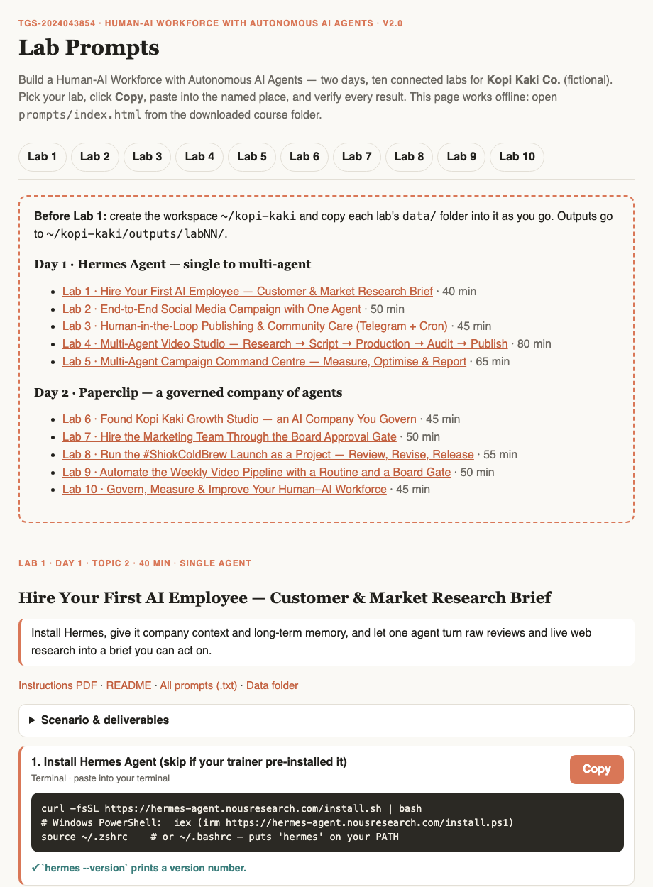
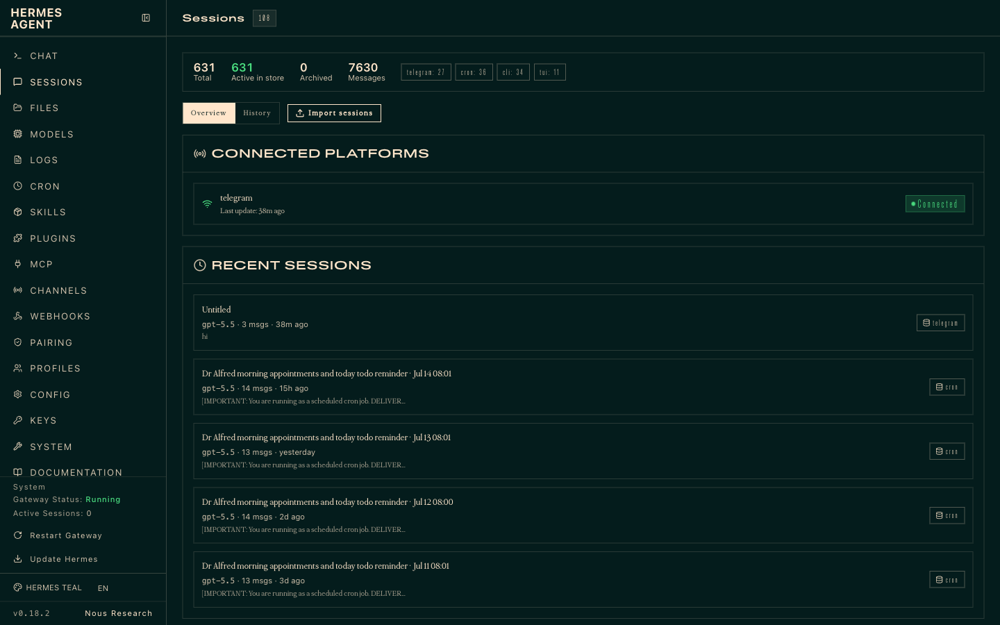
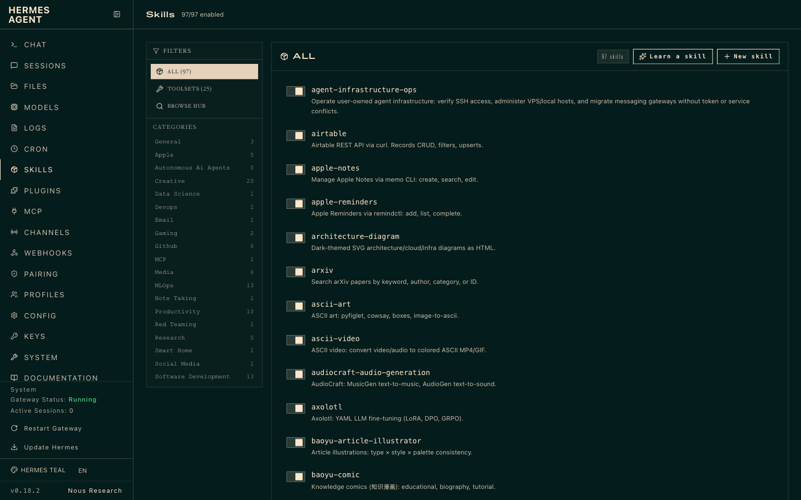
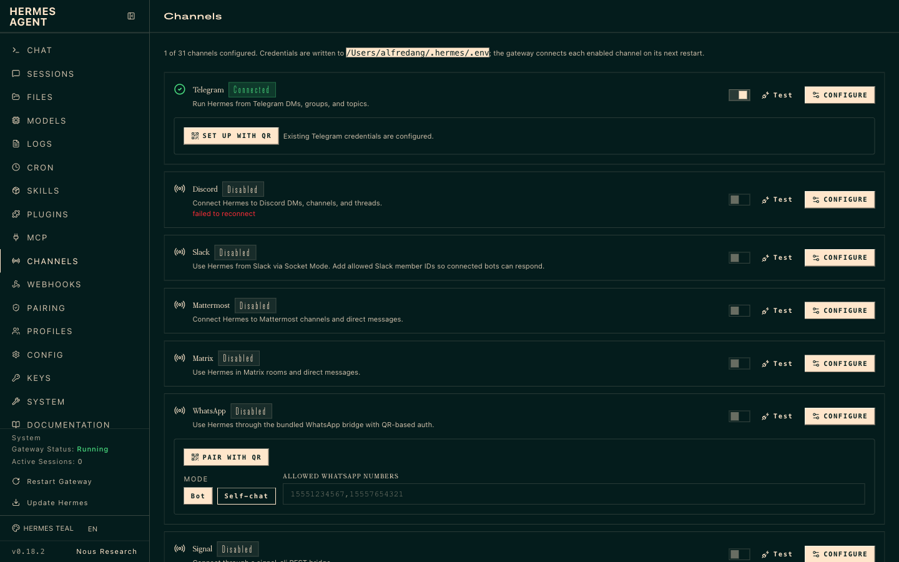
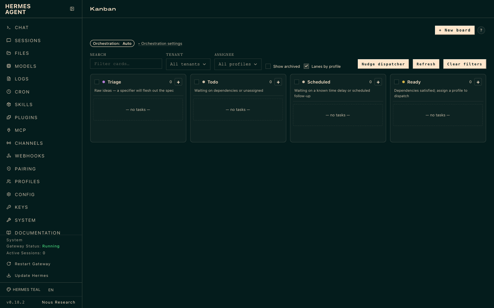
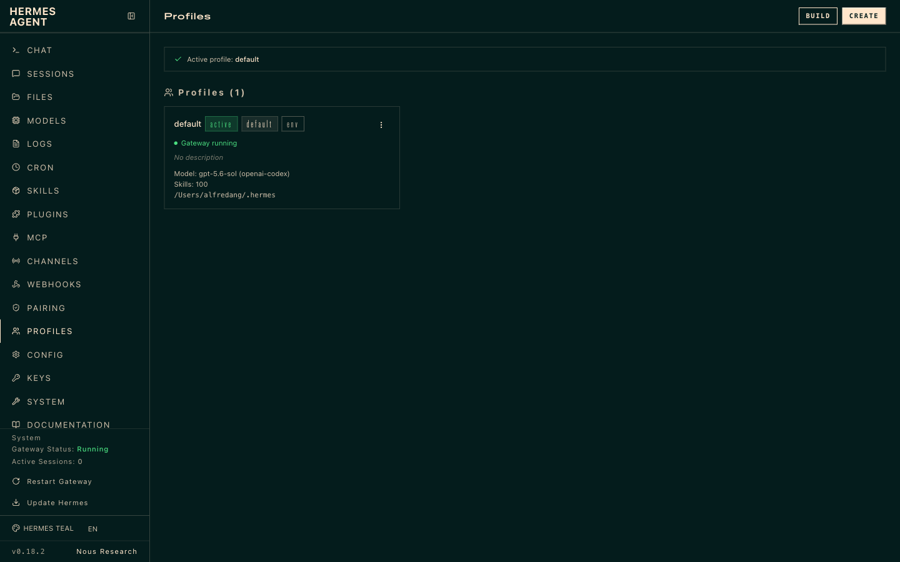
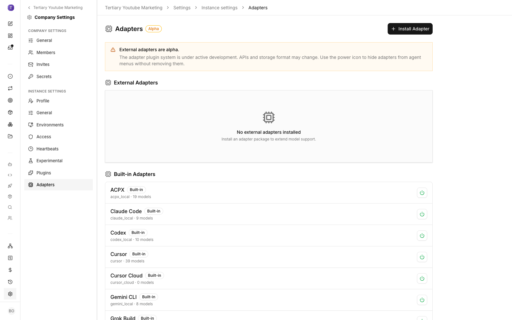
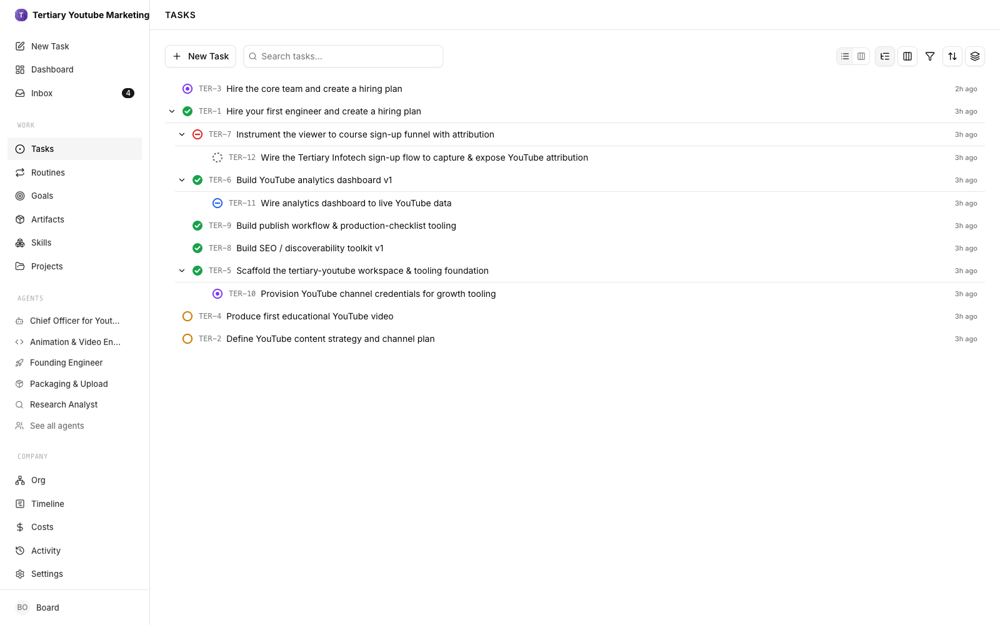
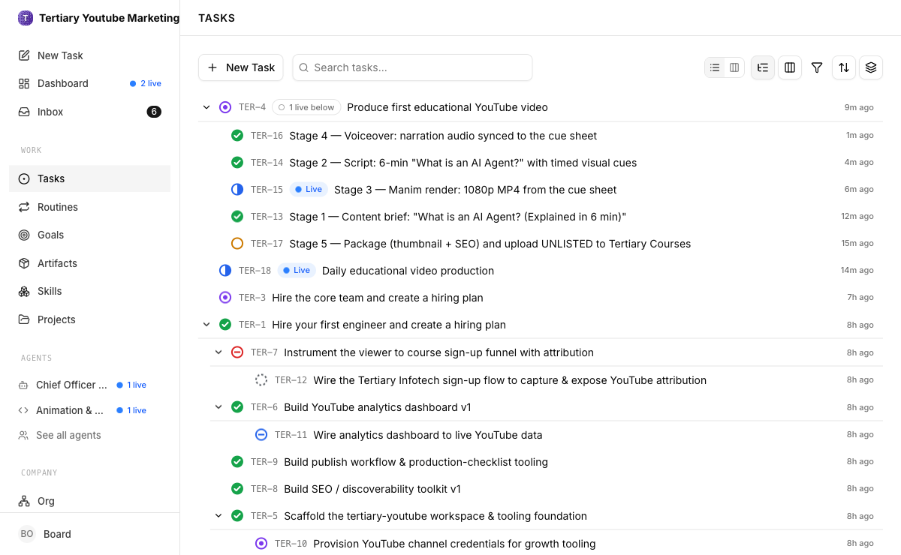
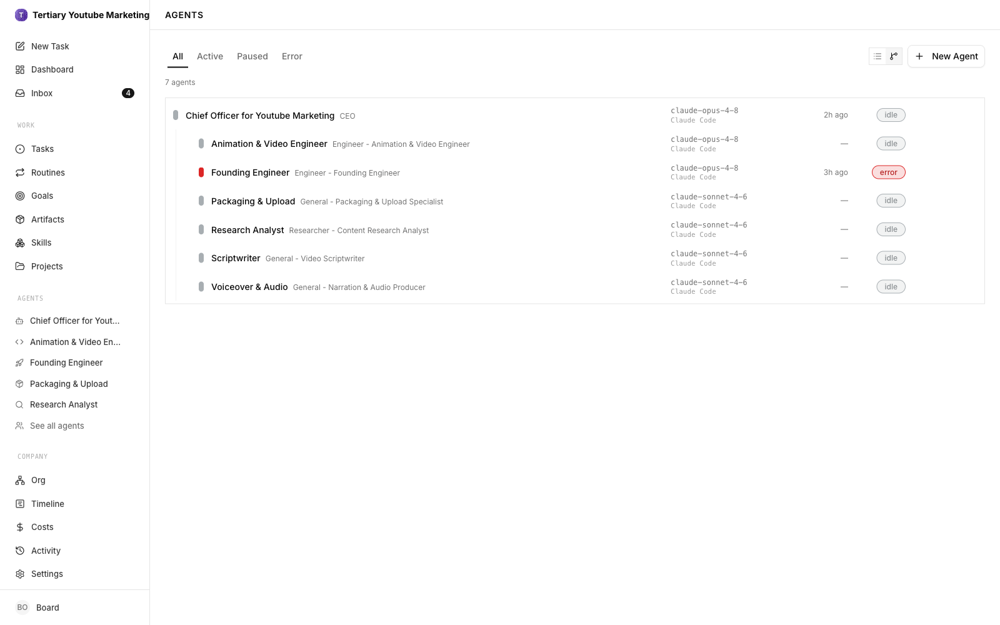

# Learner Guide — Build a Human-AI Workforce with Autonomous AI Agents

**TGS-2024043854 · Version 2.0 · 18 October 2026 · Tertiary Infotech Academy Pte Ltd (UEN: 201200696W)**

> Markdown mirror of `courseware/LG-Human-AI Workforce with Autonomous AI Agents.docx` — generated from the same source.

## Contents

- [About This Learner Guide](#about-this-learner-guide)
- [Topic 1 — Foundations of Autonomous AI Agents & the Human–AI Workforce](#topic-1--foundations-of-autonomous-ai-agents--the-humanai-workforce)
- [Topic 2 — Hermes Agent — From a Single AI Employee to a Multi-Agent Team](#topic-2--hermes-agent--from-a-single-ai-employee-to-a-multi-agent-team)
- [Topic 3 — Paperclip — Running & Governing a Company of AI Agents](#topic-3--paperclip--running--governing-a-company-of-ai-agents)
- [Assessment Preparation](#assessment-preparation)
- [Glossary](#glossary)

## About This Learner Guide

This Learner Guide accompanies the WSQ course **Build a Human-AI Workforce with Autonomous AI Agents** (TGS-2024043854). It explains the concepts of Topic 1 in depth and gives you detailed, step-by-step instructions for the ten hands-on labs. Use it during class and as an open-book reference in the assessment.

| Item | Details |
|---|---|
| Course | Build a Human-AI Workforce with Autonomous AI Agents |
| Course code | TGS-2024043854 |
| Duration | 2 days (16 hours incl. assessment) |
| Provider | Tertiary Infotech Academy Pte Ltd (UEN: 201200696W) |
| Course scenario | Kopi Kaki Co. — a fictional Singapore kopi chain launching the Gula Melaka Cold Brew (#ShiokColdBrew) — all company data is fictional |
| Course repository | https://github.com/tertiarycourses/TGS-2024043854-Build-a-Human-AI-Workforce-with-Autonomous-AI-Agents |

### Learning Outcomes

- LO1: Analyse AI (LLM-based) applications across a range of industries to identify their capabilities and limitations.
- LO2: Establish the relationship between AI algorithm/agent design and chatbot/agent efficiency.
- LO3: Evaluate and improve the effectiveness of AI (RAG and agent) applications in product development.

### Course Structure

| Topic | Day | What you do |
|---|---|---|
| 1 · Foundations of Autonomous AI Agents & the Human–AI Workforce | Day 1 AM | A brief history of AI; AI agents vs agentic AI; The agentic loop & harness engineering; Brain · perception · action, memory & world models; From single agent to human–AI collaboration; The 2026 agent market, use cases & governance; Activity: Human–AI Workforce Canvas |
| 2 · Hermes Agent — From a Single AI Employee to a Multi-Agent Team | Day 1 PM | Labs 1–5 on Hermes Agent |
| 3 · Paperclip — Running & Governing a Company of AI Agents | Day 2 | Labs 6–10 on Paperclip, then the assessment |

### How to Use the Lab Materials

1. Download the course repository (Code → Download ZIP) and unzip it.
2. Open prompts/index.html in your browser. Pick a lab, click Copy and paste the prompt or command where the page says. It works offline.
3. Each lab folder labs/labNN-…/ contains README.md, LAB-NN-Instructions.pdf (printable), COPY-PROMPTS.txt and data/ (mock company files, skills and brand assets).
4. Create one workspace folder ~/kopi-kaki and copy each lab's data/ into it as you go. Outputs are saved to ~/kopi-kaki/outputs/labNN/.
5. Finish each lab with its checkpoint: evidence, not vibes.


*The Lab Prompts page (prompts/index.html)*

> **Note:** Platforms change quickly. If a command differs on your version, run it with --help and check the official docs: https://hermes-agent.nousresearch.com/docs/ and https://docs.paperclip.ing.

## Topic 1 — Foundations of Autonomous AI Agents & the Human–AI Workforce

### 1.1 A Brief History of AI

Artificial intelligence moved from hand-written rules to learning from data, then to language, and now to agents that act. Each era moved more of the 'how' from people into the machine.

| Year | Milestone | Why it matters |
|---|---|---|
| 1950 | Alan Turing proposes the imitation game (Turing test) | Turns 'Can machines think?' into a behavioural test |
| 1956 | Dartmouth workshop coins 'artificial intelligence' | AI becomes a field of study |
| 1970s–80s | Expert systems (MYCIN, XCON) | Rules + inference engine; brittle and costly to update |
| 1997 | IBM Deep Blue beats Garry Kasparov | Brute-force search wins a narrow task |
| 2012 | AlexNet wins ImageNet | Deep learning era: GPUs + big data |
| 2016 | AlphaGo beats Lee Sedol 4–1 | Deep + reinforcement learning |
| 2017 | 'Attention Is All You Need' — the Transformer | The architecture behind every LLM |
| 2022 | ChatGPT launches (30 Nov); ReAct paper | LLMs go mainstream; LLMs can reason and act |
| 2023 | GPT-4; the prompt-engineering era | Results depend on how the prompt is worded |
| 2024 | Model Context Protocol (25 Nov 2024) | A standard way for agents to reach tools and data |
| 2025 | Coding agents (Claude Code, Codex); context engineering | Results depend on the context you curate |
| 2026 | Harness engineering named; always-on agents (OpenClaw, Hermes Agent, Paperclip, OpenAI Dots, Meta Muse) | Agents work 24/7 inside human-governed systems |

**Prompt → context → harness engineering.** Prompt engineering crafts one instruction. Context engineering curates everything the model sees — brand guide, brief, data, memory, tool results. Harness engineering designs the whole environment around the model: the loop, tools, memory, skills, verification, guardrails and human gates. Each layer contains the one before it.

#### The range of AI applications today

| Category | Examples | Key capability |
|---|---|---|
| Generative AI / LLMs | Chatbots, writing, coding, summarising | Understand and generate natural language, code and images |
| Computer vision | Defect detection, medical imaging, visual product search | Recognise and classify what is in images and video |
| Predictive analytics & machine learning | Demand forecasting, fraud scoring, recommendations | Learn patterns in historical data to predict outcomes |
| Speech & multimodal | Voice assistants, transcription, text-to-speech | Convert between speech, text and other media |
| Scientific discovery | AlphaFold, AI co-scientist, AlphaEvolve | Generate and rank hypotheses or designs for experts to test |
| Autonomous AI agents | Hermes Agent, Paperclip, OpenAI Dots, Synapxe AgentSea | Pursue a goal with tools, memory and planning, with humans in the loop |

<sub>Sources: Turing (1950); Vaswani et al. (2017); Anthropic, Model Context Protocol (Nov 2024); Anthropic, Effective context engineering for AI agents (Sep 2025).</sub>

### 1.2 AI Agents vs Agentic AI

An **AI agent** is an autonomous software entity that executes a goal-directed task in a bounded digital environment: one LLM plus tools, cycling through perceive → reason → act. **Agentic AI** is a system of several specialised agents coordinated by an orchestrator, with dynamic task decomposition, persistent shared memory and coordinated autonomy.

| Dimension | AI Agent | Agentic AI |
|---|---|---|
| Scope | One specific, well-defined task | A complex, multi-step goal or workflow |
| Architecture | One LLM + tools | Several specialised agents + an orchestrator |
| Flow | User → Agent → Tool | User → System → Agent 1 → Agent 2 → … |
| Memory | Session context, optional cache | Shared, persistent memory across stages |
| Planning | Single-step, reactive | Multi-step, proactive goal decomposition |
| Coordination | Works alone | Hierarchical or decentralised hand-offs |
| In this course | Lab 1 research agent, Lab 2 campaign agent | Lab 4 video studio, Lab 5 swarm, Labs 6–10 AI company |
| Main risks | Hallucination, brittle prompts | Error propagation, misalignment, governance |

Analogy: a smart thermostat that holds 21°C is an AI agent. A smart home whose weather, energy-price, schedule, appliance and security agents pre-cool the house with solar power before a heatwave hits at peak price is agentic AI.

<sub>Source: Sapkota, Roumeliotis & Karkee, 'AI Agents vs. Agentic AI: A Conceptual Taxonomy, Applications and Challenges', Information Fusion (2025), arXiv 2505.10468.</sub>

### 1.3 The Agentic Loop

Every agent task runs the same repeating cycle: **gather context → take action → verify work → repeat** until the goal is met. ReAct (2022) describes the same idea as Thought → Action → Observation.

| Step | What the agent does | Lab 1 example |
|---|---|---|
| Gather context | Reads files and memory, searches, calls tools | Loads AGENTS.md, reads 60 reviews, searches cold-brew trends |
| Take action | Writes files, runs commands, calls APIs/MCP tools | Writes review-insights.md and research-brief.md |
| Verify | Checks results — checklist, test, screenshot, second agent | Every claim needs a review ID or URL |
| Repeat | Feeds results back as new context | Revises the brief after your challenge |

- Give direction, not micro-steps — state the goal, constraints and definition of done.
- Verification is everything — an agent is only as good as its ability to check its work.
- Steer mid-loop — review plans and drafts early, send work back with specific feedback.
- Context is the fuel — what the agent can see decides what it can do.

<sub>Sources: Anthropic, Building agents with the Claude Agent SDK (Sep 2025); Yao et al., ReAct (arXiv 2210.03629).</sub>

### 1.4 Harness Engineering

**Agent = Model + Harness.** The harness is everything around the model that turns it into a dependable worker. Harness engineering is designing that environment — and treating every agent mistake as something to fix permanently in the environment rather than re-explaining it in chat. Anthropic described long-running agent harnesses in Nov 2025; Mitchell Hashimoto named 'engineer the harness' and OpenAI's Codex team popularised 'harness engineering' in Feb 2026 ('Humans steer. Agents execute.' — ~1M lines of code with no hand-written code).

| Harness component | What it does | Where you use it |
|---|---|---|
| Agent loop | Runs gather → act → verify → repeat | Every Hermes and Paperclip run |
| Tools & MCP | Lets the model act | Web search, files, terminal, image generation |
| Context management | Keeps the right tokens in the window | AGENTS.md, company instructions |
| Memory | Persists across sessions | MEMORY.md / USER.md; Paperclip history |
| Skills | Procedural know-how on demand | kopi-brand-voice, campaign planner, compliance audit |
| Verification | Checklists, auditors, verifiers | Self-check tables, auditor profile, swarm verifier |
| Guardrails | Permissions, budgets, approval gates | Telegram APPROVE, blocked tasks, Board approvals, budgets |
| Sub-agents & orchestration | Focused agents, coordinated | Profiles + Kanban, swarms, Paperclip org chart |
| Observability | Logs, costs, audit trail | Kanban history, Audit → Activity/Costs |

<sub>Sources: Anthropic, Effective harnesses for long-running agents (Nov 2025); M. Hashimoto, My AI Adoption Journey (Feb 2026); OpenAI, Harness engineering (Feb 2026).</sub>

### 1.5 How an Agent Works: Perception · Brain · Action

The survey 'The Rise and Potential of Large Language Model Based Agents' (Xi et al., Fudan University, arXiv 2309.07864) frames an LLM agent as three parts working in a closed loop with its environment.

| Part | Role | Includes |
|---|---|---|
| Perception | Sense the world — from data to information | Multimodal input (text, image, audio, video); environment interaction (tools, web, files); information retrieval (search, RAG, memory); world modelling |
| Brain | Core cognition and decisions — from understanding to decisions | Knowledge (pre-trained, domain, common sense); memory (short- and long-term); reasoning (logic, reflection, self-correction); planning (decompose, set goals, adapt) |
| Action | Change the world — from decisions to action | Task execution (code, tools, operations); environment feedback (results, rewards); behaviour optimisation and autonomous evolution |

Perception → decision → action → feedback → new perception. In Lab 3 the feedback is literally your APPROVE / EDIT / REJECT reply on Telegram.

### 1.6 Memory: Short-Term and Long-Term

| Memory type | Human analogy | What the agent keeps | Where you see it |
|---|---|---|---|
| Short-term / working | What you are thinking about now | The context window: instructions, chat, tool results, current plan | Every session; compaction when it fills |
| Episodic (long-term) | 'What happened' | Past sessions, actions and outcomes | Hermes session search; Kanban and Paperclip history |
| Semantic (long-term) | 'Facts I know' | Facts about the company and user; knowledge bases (RAG) | MEMORY.md / USER.md; company knowledge |
| Procedural (long-term) | 'How to do things' | Skills, rules, workflows | SKILL.md skills; AGENTS.md; agent instructions |

Agents bring long-term memory back into context by **retrieval** (by recency, importance and relevance; RAG and vector search; just-in-time loading of files), and improve through **reflection** — writing lessons to memory after a failure. In Hermes, memory files load at session start, so after the agent saves something, start a new session to see it recalled.

#### RAG agent vs a standard LLM assistant

|  | RAG agent | Standard LLM assistant |
|---|---|---|
| How it answers | Retrieves from a curated, current corpus, then generates | From training data alone |
| Strengths | Grounded, cited, auditable; uses live company data | Fast to deploy; low maintenance |
| Limitations | Quality depends on corpus freshness, chunking and retrieval settings | Stale knowledge; hallucination; no provenance |
| Maintenance | Re-index and review sources regularly | Minimal |
| Evaluate on | Accuracy, relevance, latency, cost, maintenance effort | Same metrics |

<sub>Sources: Sumers et al., CoALA (arXiv 2309.02427); Park et al., Generative Agents (2023); Shinn et al., Reflexion (2023).</sub>

### 1.7 World Models

LLMs predict the next word; **world models** predict how the state of the world changes after an action, so an agent can simulate 'what if I do X?' before acting. They matter for planning, physical AI (robots, vehicles), safe training in generated worlds, and grounding.

| Date | System | What it is |
|---|---|---|
| Jan 2025 | NVIDIA Cosmos | World foundation models for robots and autonomous vehicles |
| Jun 2025 | Meta V-JEPA 2 | Video world model; zero-shot robot pick-and-place |
| Aug 2025 | Google DeepMind Genie 3 | Interactive worlds from text at 24 fps, 720p |
| Nov 2025 | World Labs Marble | Persistent, editable 3D worlds from text or images |
| Mar 2026 | AMI Labs (Yann LeCun) | US$1.03B raised to build JEPA-based world models |

### 1.8 From Single Agent to Human–Agent Collaboration

| Paradigm | Forms | In this course |
|---|---|---|
| Single agent | Task-oriented, innovation-oriented, lifecycle-oriented | Labs 1–2: one agent researches and runs a campaign |
| Multi-agent | Cooperative — ordered (SOP pipeline) or disordered (discussion, voting); adversarial (debate) | Lab 4 ordered pipeline; Lab 5 parallel swarm with a verifier |
| Human–agent collaboration | Instructor–executor (humans instruct and give feedback); equal partnership (agents as peers) | Lab 3 APPROVE gate; Day 2 Board approvals; CEO proposes, you decide |

Without rules, multi-agent conversation can amplify small hallucinations — add verifiers, cross-checks and human checkpoints. At scale, agents form an **agent society**: individual behaviour, group interaction, personality (SOUL.md, instructions) and social emergence — and 'Agent-as-a-Service', the idea behind Paperclip.

#### Levels of autonomy — pick per task, not per agent

| Level | Your role | What the agent does | Course example |
|---|---|---|---|
| L1 | Operator | Acts only when invoked for a subtask | A one-off question to Mia |
| L2 | Collaborator | Plans and works with you | Lab 2 drafting with feedback |
| L3 | Consultant | Does most of the work; asks for expertise | Lab 1 brief; Lab 7 hiring plan |
| L4 | Approver | Asks only at high-risk steps or approvals | Lab 3 APPROVE; Lab 9 weekly routine |
| L5 | Observer | Works alone; you monitor with an off-switch | Lab 5 weekly report cron |

| Pattern | Definition | Use for |
|---|---|---|
| Human-in-the-loop | A person approves BEFORE the action | Irreversible, public, regulated actions |
| Human-on-the-loop | Agent acts; a person monitors and can intervene | High-volume, reversible work |
| Human-out-of-the-loop | Fully autonomous | Only low-risk, bounded, reversible tasks |

<sub>Sources: Xi et al. (arXiv 2309.07864); Feng, McDonald & Zhang, Levels of Autonomy for AI Agents (arXiv 2506.12469).</sub>

### 1.9 The 2026 Agent Market

| Product | Vendor · launch | Type | Human-in-the-loop |
|---|---|---|---|
| OpenClaw | OpenClaw Foundation · Nov 2025 (renamed Jan 2026) | Open-source personal agent on your machine, via chat apps | DM pairing; optional sandbox |
| Hermes Agent | Nous Research · ~Feb 2026 | Open-source, self-improving agent; memory, skills, cron, profiles, Kanban | Approval modes; allow-lists |
| Paperclip | Paperclip Labs · Mar 2026 | Open-source company of agents (org chart, budgets) | Board approvals; budgets auto-pause; audit log |
| OpenAI Dots | OpenAI · 29 Sep 2026 | Always-on agents with their own cloud computer (ChatGPT, Slack, Teams) | Custom rules: allow / approve / block |
| Meta Muse | Meta · 8 Sep 2026 (US) | Personal agent for life admin (app, web, WhatsApp) | Confirms sensitive actions; Sentinel guard agent |
| Block Buzz | Block · 21 Jul 2026 | Open-source workspace for humans and agents (Nostr) | Agent identities and permissions |
| Manus Cue | Manus · 28 Sep 2026 | Agents with their own email, phone, wallet and computer | Budgets; you make the final call |
| Claude Cowork / Claude Code | Anthropic · 2025–2026 | Desktop and coding agents with sub-agents | Manual / Auto / Skip permission modes |
| OpenAI Codex | OpenAI · 2025–2026 | Parallel coding agents | Review before merge; sandboxes |
| Gemini Enterprise agents | Google · 8 Oct 2026 | Sub-agents and persistent 'coworker' agents | Agent identity, gateway, spend caps |
| Microsoft Agent 365 | Microsoft · May 2026 | Governance control plane for many agents | Registry, access control, DLP |

Read the market in four groups: **personal agents** (one agent for one person), **workspaces and companies** (many agents and humans with roles), **governance layers** (registries, identities, budgets) and **open vs closed** (self-host and own your data, or convenience and managed security). This course uses two open-source platforms: Hermes Agent — an employee that learns — and Paperclip — the company you govern.

<sub>Sources: vendor announcements and repositories, verified Oct 2026. Products change quickly — check before you buy.</sub>

### 1.10 Singapore in Focus


*The Straits Times, 24 Aug 2026 — 'New platform to create AI agents available to all public healthcare professionals'*

**AgentSea**, an agentic AI platform by national healthtech agency Synapxe and AWS, lets Singapore's 80,000+ public healthcare professionals create their own AI agents in natural language. Since its launch at the end of May 2026, more than **12,000 agents** have been created and 300+ shared for reuse. A National Heart Centre Singapore cardiologist halved his pre-consultation preparation, and KK Women's and Children's Hospital built an agent that generates daily rosters. Guardrails protect patient data, and clinicians still verify: the tool 'has not replaced the need for verification or my own clinical assessment'. Announcing it at HIMSS26 APAC, Senior Minister of State Tan Kiat How said: 'We are moving from AI as assistant to AI as actor.'

Singapore's governance anchor is IMDA's **Model AI Governance Framework for Agentic AI** (launched 22 Jan 2026; updated May 2026), with four dimensions: assess and bound risks upfront, meaningful human accountability (including approval checkpoints), technical controls, and end-user responsibility. GovTech's AI Assistant Desk keeps a registry of each agent's owner and purpose.

<sub>Sources: The Straits Times (Zhaki Abdullah, 24 Aug 2026); Synapxe and MOH releases (24 Aug 2026); IMDA (Jan/May 2026).</sub>

### 1.11 Human–AI Collaboration in Action

| Domain | Example | What the agent does | What the human does |
|---|---|---|---|
| Science | Google AI co-scientist (2025) | Generates, debates and ranks hypotheses | Sets the goal, picks hypotheses, runs wet-lab tests (3 of 5 leukaemia ideas worked) |
| Science | Edison Kosmos (2025) | Reads ~1,500 papers, writes ~42,000 lines of analysis per run | Sets the objective, judges which findings matter |
| Mathematics | Gemini Deep Think (2025) | Writes natural-language proofs | IMO coordinators certify — gold, 35/42 |
| Mathematics | AlphaEvolve + Terence Tao (2025–26) | Evolves programs and constructions | Defines the problem, WRITES the evaluator, proves and generalises |
| Drug discovery | AlphaFold 3 (2024) | Predicts biomolecular structures | Chooses targets, validates in the lab (2024 Nobel Prize) |
| Drug discovery | Insilico rentosertib (2025) | Found the TNIK target and designed the molecule | Clinicians ran the Phase 2a trial; regulators approved |
| Healthcare | Microsoft MAI-DxO (2025) | Virtual panel orders tests step by step | Clinician owns diagnosis (benchmark only) |
| Finance | Goldman Sachs + Anthropic (2026) | Trade accounting, client onboarding | Staff review exceptions and approve |
| Software | OpenAI Codex harness (2026) | Writes code, tests, CI, docs | Engineers steer, review, build feedback loops |
| Customer service | Klarna (2024–25) | Handles routine chats | Takes complex cases — human access re-prioritised in 2025 |
| Marketing | This course | Drafts, designs, schedules, reports | Sets strategy, approves everything public |

**The pattern:** the agent searches, generates, runs and checks at scale; the human sets the goal, defines 'good' (rubric, evaluator, tests), approves consequential actions, interprets meaning and owns accountability. Counter-evidence matters too: a 2025 METR trial found experienced developers 19% slower with early AI tools — the harness and the human make the difference.

### 1.12 Risks, Governance and Security

| Challenge | Mitigation |
|---|---|
| Hallucination | Require citations; verifier agents; human spot-checks |
| Security risks (prompt injection, poisoned skills, leaked keys) | Least privilege, secrets, sandboxes, review skills before installing |
| Explainability | Logs, Kanban history, Paperclip audit trail |
| Data and bias (PDPA) | Mask personal data; review outputs |
| Efficiency and cost | Budgets; cheaper models for simple roles |

| Security principle | Question it answers | Control in the labs |
|---|---|---|
| Data control | What can the AI see? | Only the workspace files it needs |
| Permission control | What can the AI do? | Approval modes; allow-listed Telegram user |
| Human approval | When must it ask? | APPROVE on Telegram; blocked publish task; Board approvals |
| Monitoring & audit | What did it do? | Kanban history; Audit → Activity/Costs |
| Kill switch | How do I stop it? | hermes pause; Paperclip Pause; disable routines |

### 1.13 Activity — Human–AI Workforce Canvas

1. In pairs, list 8–10 tasks in Kopi Kaki's #ShiokColdBrew campaign (research, posts, video, replies, reporting …).
2. Mark the tasks one agent can do end to end (SINGLE).
3. Mark the tasks that need several specialised agents — pipeline or swarm (TEAM).
4. Mark the decisions that must stay human, and why — risk, accountability, judgement (HUMAN).
5. Draw where the human approves: before public posts, refunds, spend.
6. Start the Hermes Agent install now (Lab 1, step 1). Once installed, ask Hermes to critique your canvas:

```text
Here is our Human-AI Workforce Canvas for Kopi Kaki Co.'s #ShiokColdBrew campaign:
<paste your task list with SINGLE / TEAM / HUMAN labels and approval checkpoints>

Act as an operations consultant. For each task:
1. Agree or disagree with our label and say why (risk, reversibility, volume, judgement).
2. Suggest the autonomy level (L1 Operator ... L5 Observer).
3. Name one control (approval gate, budget, audit, verifier) we must add.
End with the 3 biggest risks in our design.
```

## Topic 2 — Hermes Agent — From a Single AI Employee to a Multi-Agent Team

Hermes Agent (Nous Research, MIT licence) is a self-hosted, self-improving agent with persistent memory, skills, tools and MCP, a messaging gateway (Telegram and 15+ channels), a cron scheduler, and profiles + a Kanban board for multi-agent teams. On Day 1 you take it from one AI employee to a supervised five-agent studio.


*The Hermes dashboard (hermes dashboard → http://127.0.0.1:9119)*

| File / place | What it holds | Loaded |
|---|---|---|
| AGENTS.md (in the folder you start Hermes in) | Company context and rules | Every session in that folder |
| ~/.hermes/SOUL.md (per profile) | The agent's role, personality, standing rules | Every session |
| ~/.hermes/memories/MEMORY.md and USER.md | What the agent chose to remember; what it knows about you | Session start |
| ~/.hermes/skills/ | Skills (SKILL.md folders) | On demand, by description |
| Kanban board | Tasks, dependencies, comments, history | Dispatched by the running gateway |

### Lab 1 — Hire Your First AI Employee — Customer & Market Research Brief

**Day 1 · 55 min · Single agent · LO1** — Install Hermes, give it company context and long-term memory, and let one agent turn raw reviews and live web research into a brief you can act on.

#### Business scenario

You are Kopi Kaki Co.'s Marketing Lead. The Gula Melaka Cold Brew launches on 1 Dec and you have 60 unread customer reviews, a competitor list and no analyst. You 'hire' Mia — a Hermes Agent marketing analyst — onboard her with the company context, and ask for a research brief that tells you which campaign angle to run.

#### Goal

Install and configure an autonomous LLM agent, give it context and long-term memory, and analyse its perception → reasoning → action loop on a real research task (LO1).

#### Before you start

- A laptop (macOS, Linux or Windows with WSL2) with admin rights and internet access
- An LLM provider sign-in or API key (Nous Portal, OpenRouter, OpenAI/Codex, Anthropic)
- This lab folder downloaded (course repo → Code → Download ZIP)


*Lab 1 — the Hermes dashboard: sessions of your onboarded agent (hermes dashboard)*

#### You will deliver

- outputs/lab01/review-insights.md — ratings, themes and evidence (review IDs)
- outputs/lab01/research-brief.md — trends, competitors, 3 campaign angles with evidence
- Mia's long-term memory holds the brand facts and YOUR chosen angle (recalled in a new session)

| Who | Role |
|---|---|
| Agents | 1 Hermes agent — 'Mia', AI marketing analyst |
| You (human) | Set the goal, challenge the evidence, choose the campaign angle |

#### Concepts in action

- Perception (files + web) → Brain (LLM reasoning, memory) → Action (write files)
- AGENTS.md = context the agent loads automatically (context engineering)
- Short-term memory (this session) vs long-term memory (MEMORY.md, recalled next session)
- Human-in-the-loop: the agent recommends, the human decides

#### Lab files

labs/lab01-hermes-first-ai-employee/ — README.md, LAB-01-Instructions.pdf, COPY-PROMPTS.txt and data/. Copy data/ into ~/kopi-kaki.

#### Step-by-step

**Step 1 — Install Hermes Agent (skip if your trainer pre-installed it)**

macOS / Linux / WSL2 — run the one-line installer in Terminal. Windows — use the PowerShell installer (or install inside WSL2). The installer sets up Python, Node.js, ripgrep and ffmpeg for you.

```bash
curl -fsSL https://hermes-agent.nousresearch.com/install.sh | bash
# Windows PowerShell:  iex (irm https://hermes-agent.nousresearch.com/install.ps1)
source ~/.zshrc    # or ~/.bashrc — puts 'hermes' on your PATH
```

✓ Expected: `hermes --version` prints a version number.

**Step 2 — Connect a model and check health**

Run the setup wizard and choose a provider (Nous Portal, OpenRouter, OpenAI/Codex, Anthropic …). Pick a model with a context window of at least 64,000 tokens. Then run the doctor.

```bash
hermes setup
hermes doctor
```

✓ Expected: `hermes doctor` shows green checks for the model and tools.

**Step 3 — Create the Kopi Kaki workspace and add the lab data**

Download this lab's folder (or the whole course repo) and copy everything in `data/` into a new folder `~/kopi-kaki`. Hermes automatically loads `AGENTS.md` from the folder you start it in — that is how Mia learns who the company is.

```bash
mkdir -p ~/kopi-kaki/outputs/lab01
cp -R data/* ~/kopi-kaki/
cd ~/kopi-kaki
hermes
```

✓ Expected: The Hermes chat opens. Type `/help` to see slash commands.

**Step 4 — Onboard Mia — persona and long-term memory**

Prompt — paste into *Hermes chat (started inside ~/kopi-kaki)*:

```text
You are Mia, Kopi Kaki Co.'s AI marketing analyst. Read AGENTS.md, brand-guide.md and campaign-brief.md in this folder.

Save these facts to your long-term memory:
- Kopi Kaki Co.: Singapore kopi chain, 12 outlets, positioning "Heritage kopi, modern craft".
- Launch: Gula Melaka Cold Brew, SGD 6.80, launches 1 Dec 2026, campaign #ShiokColdBrew 17 Nov - 14 Dec.
- Promo SHIOK20: 20% off the first Gula Melaka Cold Brew ordered in the app, valid 1-14 Dec 2026, one per customer.
- Never publish anything without my APPROVE. Never make health or halal claims.

Then summarise the company in 5 bullets and ask me the 3 questions a new analyst should ask on day one.
```

✓ Expected: Mia confirms the memory was saved and returns 5 bullets + 3 questions. Check the file itself: `cat ~/.hermes/memories/MEMORY.md` shows the facts.

**Step 5 — Perceive the data — analyse 60 customer reviews**

Prompt — paste into *Hermes chat*:

```text
Analyse customer-reviews.csv.
1. Rating distribution (count and % for 1-5 stars) and average rating per outlet.
2. The top 5 praise themes and top 5 complaint themes, each with a count and 2 example review_ids.
3. Anything relevant to a cold-brew launch (mentions of cold brew, sweetness, oat milk, app).
Show your calculation method. Save the result as outputs/lab01/review-insights.md.
```

✓ Expected: A Markdown report with a ratings table and themes that cite review IDs (e.g. R1012).

**Step 6 — Perceive the world — live web research**

Prompt — paste into *Hermes chat*:

```text
Use web search to research specialty coffee and cold-brew trends in Singapore in 2026 (consumer preferences, price points, social media formats that work). Combine this with competitors.csv (the competitors are fictional - treat them as our internal notes).
Rules: cite every web fact with its URL; mark anything you could not verify as UNVERIFIED; do not invent statistics.
```

✓ Expected: 5+ cited findings with URLs and a competitor comparison table.

**Step 7 — Act — write the research brief**

Prompt — paste into *Hermes chat*:

```text
Write outputs/lab01/research-brief.md for the Marketing Lead with:
1. Executive summary (5 lines).
2. What our customers say (from review-insights.md).
3. Market & competitor snapshot (cited).
4. Three campaign angles for #ShiokColdBrew. For each: the big idea, target audience, supporting evidence (review IDs or URLs), the KPI it drives, and one risk.
5. A final section "Decision needed" asking me to choose one angle.
Follow the brand guide and compliance rules.
```

✓ Expected: research-brief.md with three evidence-backed angles and a 'Decision needed' section.

**Step 8 — Human checkpoint — challenge, then decide**

Read the brief like a manager. Challenge at least one claim, then make the decision and tell Mia to remember it.

Prompt — paste into *Hermes chat*:

```text
Which review_ids support angle 2? Quote them. Then: I choose angle <1|2|3> because <your reason>. Save my decision and reason to long-term memory, and add a "Decision log" section to research-brief.md.
```

✓ Expected: Mia quotes the supporting reviews, updates the brief and confirms the memory write.

**Step 9 — Test long-term memory in a brand-new session**

First confirm the decision is in the memory file. Then exit with `/exit`, start a fresh session and ask Mia what she remembers. A new session has an empty short-term memory; memory files load at session start, so the answer should come from MEMORY.md (ask her where it came from — 'I'll remember' in a chat is not proof).

```bash
cat ~/.hermes/memories/MEMORY.md
hermes
```

Prompt — paste into *New Hermes chat*:

```text
Which campaign angle did I choose, and why? What is the promo code and its terms? Tell me whether you got this from your memory file or by searching past sessions.
```

✓ Expected: Mia answers correctly without re-reading the files.

#### Test it

> **✅ Test it:** Every insight cites review IDs or a URL; the angle you chose is recalled in a brand-new session.
>
> - [ ] outputs/lab01/review-insights.md and research-brief.md exist and cite review IDs / URLs
> - [ ] The brief ends with a decision log naming the angle you chose
> - [ ] MEMORY.md contains the brand facts and your decision
> - [ ] A new session recalls the chosen angle and the SHIOK20 terms
> - [ ] PP evidence: take ONE screenshot now of the research brief or the memory recall — Task 1 of the Practical Performance uses it

#### Troubleshooting

| Symptom | Fix |
|---|---|
| `hermes: command not found` | Open a new terminal or run `source ~/.zshrc` (macOS) / `source ~/.bashrc` (Linux/WSL2). |
| Model errors / context too small | Re-run `hermes setup` (or `hermes model`) and choose a model with ≥ 64k context. |
| Web search not available | Run `hermes tools` and enable the web toolset. Keyless search works for light use; for reliability add a free key, e.g. `hermes config set TAVILY_API_KEY tvly-...` (you reuse it on Day 2). |
| Windows paths | On native Windows Hermes keeps its data in %LOCALAPPDATA%\hermes instead of ~/.hermes — or run the labs inside WSL2. |
| Mia ignores the brand rules | Make sure you started `hermes` inside ~/kopi-kaki so AGENTS.md is loaded. |

#### Stretch challenge

Ask Mia: "Save the review-analysis procedure you just used as a reusable skill called review-insights." Then run `hermes skills list` — a self-improving agent turns experience into procedural memory.

### Lab 2 — End-to-End Social Media Campaign with One Agent

**Day 1 · 60 min · Single agent + skills · LO1** — Give the agent two company skills and one tool chain, and turn the brief into a complete, dated, on-brand multi-platform campaign — then improve it with your feedback.

#### Business scenario

With the angle chosen, you need a campaign: strategy, a 14-day content calendar across Instagram, TikTok, Facebook and LinkedIn, captions in the Kopi Kaki voice, visuals and tracking links. Instead of a long prompt you give Mia two skills — the company's brand-voice skill and a campaign-planner skill — so the work is repeatable and self-checked.

#### Goal

Analyse the capabilities and limitations of an LLM agent on an end-to-end marketing workflow, and how skills, tools and instructions shape its output (LO1).

#### Before you start

- Lab 1 complete: Hermes installed, ~/kopi-kaki workspace, the angle you chose saved in memory
- Optional: an image-generation backend (paid Nous Portal plan or a FAL_KEY)


*Lab 2 — the Skills page: your kopi-brand-voice and social-campaign-planner skills appear here*

#### You will deliver

- outputs/lab02/campaign-plan.md — strategy, pillars, phases, KPIs, budget split
- outputs/lab02/content-calendar.csv — ≥ 16 dated posts with UTM links
- outputs/lab02/captions.md — captions with a compliance self-check per post
- outputs/lab02/images/ — 3 hero visuals (or image prompts if no image tool)
- A revised v2 after your feedback

| Who | Role |
|---|---|
| Agents | 1 Hermes agent (Mia) + 2 custom skills + image tool |
| You (human) | Review the draft, give concrete feedback, accept v2 |

#### Concepts in action

- Skills = procedural memory: a SKILL.md the agent loads on demand
- Tools = actions: file write, web search, image generation
- Self-check inside the skill = built-in verification step of the agentic loop
- Human feedback → revision = instructor–executor collaboration

#### Lab files

labs/lab02-hermes-social-media-campaign/ — README.md, LAB-02-Instructions.pdf, COPY-PROMPTS.txt and data/. Copy data/ into ~/kopi-kaki.

#### Step-by-step

**Step 1 — Install the two company skills**

Skills live in `~/.hermes/skills/`. Copy the two skill folders from this lab's data into a `marketing` category, then confirm Hermes can see them. (Optional: also install the official social-media-content-calendar skill.)

```bash
cp -Rn data/* ~/kopi-kaki/
mkdir -p ~/kopi-kaki/outputs/lab02/images ~/.hermes/skills/marketing
cp -R ~/kopi-kaki/skills/* ~/.hermes/skills/marketing/
hermes skills list | grep -E "kopi-brand-voice|social-campaign-planner"
# optional: hermes skills install official/creative/social-media-content-calendar
```

✓ Expected: Both skills appear in the list.

**Step 2 — Read a skill before you trust it**

Open `~/.hermes/skills/marketing/kopi-brand-voice/SKILL.md`. Notice the frontmatter `description` (when the agent should load it), the steps, and the self-check table. A skill is a contract you can review — like an SOP for a new hire.

```bash
cat ~/.hermes/skills/marketing/kopi-brand-voice/SKILL.md
```

**Step 3 — Build the campaign plan and calendar**

Prompt — paste into *Hermes chat in ~/kopi-kaki*:

```text
Use the social-campaign-planner skill to build the #ShiokColdBrew campaign from campaign-brief.md, using the angle I chose in Lab 1 (check your memory).
Scope: teaser (17-23 Nov) and pre-order push (24-30 Nov) phases, Instagram, TikTok, Facebook and LinkedIn.
Deliver:
- outputs/lab02/campaign-plan.md
- outputs/lab02/content-calendar.csv with at least 16 posts (use the columns in the skill)
- outputs/lab02/captions.md with every caption checked by the kopi-brand-voice skill
End with a 5-line summary of decisions you need from me.
```

✓ Expected: Three files in outputs/lab02 and a decisions summary.

**Step 4 — Create the hero visuals**

Prompt — paste into *Hermes chat*:

```text
Create 3 hero visuals for the teaser posts using your image generation tool: square 1:1, brand colours (kopi brown #5B3A29, pandan green #4E8A3E, cream #F6EBD9, gula melaka amber #C7782A), natural light, a glass of iced cold brew with a gula melaka drizzle, kopitiam tiles, no people's faces, no text in the image. Save them to outputs/lab02/images/ and add the file names to content-calendar.csv. If you have no image tool, write the 3 prompts to outputs/lab02/images/prompts.md instead.
```

✓ Expected: 3 PNGs (or a prompts file) linked from the calendar.

**Step 5 — Human review — give concrete, testable feedback**

Open the calendar in a spreadsheet and the captions in a viewer. Vague feedback ('make it better') produces vague revisions. Give specific, checkable changes — for example:

Prompt — paste into *Hermes chat*:

```text
Review feedback for v2:
1. TikTok hooks are weak - rewrite every TikTok caption to open with a question in under 8 words.
2. LinkedIn must not mention SHIOK20 - make the LinkedIn posts about our roasting team and heritage.
3. Add one post per phase aimed at students (18-24).
Apply the changes, re-run the kopi-brand-voice self-check on every changed caption, save as content-calendar-v2.csv and captions-v2.md, and list exactly what changed.
```

✓ Expected: v2 files plus a change log; changed captions all PASS.

**Step 6 — Measure efficiency — what did the skills save?**

Ask the agent to report its own work so you can relate design to efficiency (this is the LO2 analysis you will use in the assessment).

Prompt — paste into *Hermes chat*:

```text
Report: how many posts, captions and images you produced; how many self-check FAILs you found and fixed before showing me; and which parts of the work the two skills standardised. Then estimate how long the same work would take one human marketer.
```

✓ Expected: A short efficiency report you can quote.

#### Test it

> **✅ Test it:** Every caption carries a PASS self-check; no health/halal claims; SHIOK20 always shows its terms.
>
> - [ ] campaign-plan.md, content-calendar(-v2).csv and captions(-v2).md exist in outputs/lab02
> - [ ] ≥ 16 posts across 4 platforms with UTM links; LinkedIn has no promo code
> - [ ] Each caption has a PASS self-check table

#### Troubleshooting

| Symptom | Fix |
|---|---|
| Skill not listed | Check the path is ~/.hermes/skills/marketing/<skill>/SKILL.md and start a new session (`/new`) — skills and memory load at session start. |
| No images generated | Image generation runs through FAL.ai: either a paid Nous Portal plan (Tool Gateway) or your own FAL_KEY (`hermes config set FAL_KEY ...`), selected in `hermes tools`. The prompts.md fallback is acceptable. |
| CSV columns shift | Ask the agent to quote every caption field and re-save with UTF-8 encoding. |

#### Stretch challenge

Ask Mia to turn your three review comments into permanent rules by patching the kopi-brand-voice skill ("update the skill so this mistake never happens again") — that is harness engineering in one sentence.

### Lab 3 — Human-in-the-Loop Publishing & Community Care (Telegram + Cron)

**Day 1 · 45 min · Human–agent collaboration · LO2** — Put the agent on Telegram, make it ask for your APPROVE before anything goes public, schedule it every morning, and let it triage comments while escalating the risky ones to you.

#### Business scenario

The campaign is planned; now it must run every day without you babysitting it. Each morning Mia sends you the day's post and image on Telegram. Only when you reply APPROVE does she publish it to the brand's Telegram channel and log it. She also works through the comment inbox — answering simple questions, but escalating food-safety, allergy, legal, billing, media and halal questions to you with personal data masked.

#### Goal

Design a human-in-the-loop workflow — approval gates, escalation rules and scheduled automation — and relate the design to operational efficiency and risk (LO2).

#### Before you start

- Labs 1–2 complete: outputs/lab02/content-calendar-v2.csv exists
- A Telegram account on your phone or desktop


*Lab 3 — the Channels page: Telegram connected to the gateway*

#### You will deliver

- A Telegram bot connected to Hermes (your private chat with Mia)
- A 'Kopi Kaki Feed (Training)' Telegram channel where approved posts are published
- outputs/lab03/approval-log.csv — every APPROVE / EDIT / REJECT decision
- A daily 09:00 cron job that sends the day's post for approval
- outputs/lab03/moderation-queue.csv + an escalation summary on Telegram

| Who | Role |
|---|---|
| Agents | 1 Hermes agent (Mia) on the messaging gateway + cron scheduler |
| You (human) | Approve, edit or reject every post; decide every escalation |

#### Concepts in action

- Human-in-the-loop (approve before acting) vs human-on-the-loop (monitor and intervene)
- Escalation rules turn policy into agent behaviour
- Cron = proactive agent (it starts work without being asked)
- Approval modes (smart / manual / off) for risky terminal commands

#### Lab files

labs/lab03-hermes-human-in-the-loop/ — README.md, LAB-03-Instructions.pdf, COPY-PROMPTS.txt and data/. Copy data/ into ~/kopi-kaki.

#### Step-by-step

**Step 1 — Create your Telegram bot and find your user ID**

In Telegram: open @BotFather → /newbot → choose a name (e.g. 'Mia Kopi Kaki') → copy the token. Open @userinfobot to get your numeric user ID. Keep the token secret. (Shortcut: the dashboard's Messaging → Telegram page has a 'Create with QR' button.)

**Step 2 — Connect Telegram to Hermes and start the gateway**

Run the messaging setup, choose Telegram, paste the token and your user ID as the only allowed user. Then run the gateway (leave this terminal open).

```bash
hermes gateway setup
hermes gateway run      # or: hermes gateway install && hermes gateway start
```

✓ Expected: Send 'hi' to your bot in Telegram — Mia replies.

**Step 3 — Create the brand channel (the 'publish' destination)**

In Telegram create a new channel 'Kopi Kaki Feed (Training)', add your bot as an administrator with permission to post. Then list targets to find its ID.

```bash
hermes send --list telegram
```

✓ Expected: Your channel appears as telegram:<channel_id>. Copy it.

**Step 4 — Make risky commands ask first**

Create this lab's output folder and approval log, and switch approvals to manual so every dangerous terminal command pauses for you. Be clear about what this does and does not cover: approval modes gate risky TERMINAL commands; the publishing gate in this lab is a rule the agent follows (prompt-enforced, written into AGENTS.md). Lab 4 shows a runtime-enforced gate (a blocked task only you can release).

```bash
cp -Rn data/* ~/kopi-kaki/
mkdir -p ~/kopi-kaki/outputs/lab03
cp ~/kopi-kaki/templates/approval-log.csv ~/kopi-kaki/outputs/lab03/approval-log.csv
hermes config set approvals.mode manual
```

**Step 5 — Run one approval cycle by hand**

Prompt — paste into *Telegram → your bot*:

```text
Approval workflow for #ShiokColdBrew (standing rule - add it to ~/kopi-kaki/AGENTS.md too):
1. Take the next post with status "draft" from ~/kopi-kaki/outputs/lab02/content-calendar-v2.csv, set its status to "pending-approval" and send it to me here with its post id, image, platform and date. End with: Reply APPROVE <post_id>, EDIT <post_id>: <changes> or REJECT <post_id>.
2. Whenever I reply APPROVE <post_id>, read that row from the CSV - it must say "pending-approval" - then post the caption and image to telegram:<channel_id>, set the status to "published" and append a row to ~/kopi-kaki/outputs/lab03/approval-log.csv.
3. EDIT: apply my changes, re-check with kopi-brand-voice, keep "pending-approval" and send it again. REJECT: set "rejected" and log it.
4. Never publish a row that is not "pending-approval" and never without my APPROVE.
```

✓ Expected: You receive the draft with its post id; after APPROVE <post_id> it appears in the channel, the CSV says published and approval-log.csv has a row.

**Step 6 — Schedule it every morning at 09:00**

Turn step 1 of the workflow into a proactive agent. A cron job runs in its own fresh session, so it must NOT try to publish: it only marks the next post 'pending-approval' and sends it to you. Your reply goes to your normal chat with Mia, which reads the CSV state (step 2 of the rule) and publishes. The state in the CSV is what connects the two sessions. Copy the job id from `hermes cron list`.

```bash
hermes cron create "0 9 * * *" "Proposal only - never publish. Take the next post with status draft from ~/kopi-kaki/outputs/lab02/content-calendar-v2.csv, set it to pending-approval and send me its post id, image, platform, date and caption, ending with: Reply APPROVE <post_id>, EDIT <post_id>: <changes> or REJECT <post_id>." --name daily-post-approval --deliver telegram
hermes cron list
hermes cron run <job_id>
```

✓ Expected: The job is listed; the test run sends you a draft; replying APPROVE <post_id> in your chat with Mia publishes it.

**Step 7 — Triage the comment inbox with escalation rules**

Prompt — paste into *Telegram → your bot (or Hermes chat in ~/kopi-kaki)*:

```text
Triage ~/kopi-kaki/social-comments.csv using compliance-rules.md.
For each comment decide: REPLY (safe FAQ), IGNORE (spam) or ESCALATE (food safety, allergy, legal threat, billing/refund, media enquiry, halal question, health claim question, anything uncertain).
- For REPLY: draft a reply in the kopi-brand-voice skill.
- For ESCALATE: do NOT draft a public reply. Mask all personal data (names, phone numbers) and recommend the next step.
Save outputs/lab03/moderation-queue.csv (comment_id, decision, reason, draft_reply) and send me an escalation summary here.
```

✓ Expected: 7 escalations summarised on Telegram with phone numbers masked; safe replies drafted.

**Step 8 — Decide like a manager**

Reply on Telegram with your decision for each escalation (e.g. 'C06: call the customer today, ops to inspect Bishan'). Approve the batch of FAQ replies. Discuss: which decisions must always stay human, and which could move to human-on-the-loop later?

#### Test it

> **✅ Test it:** Nothing reaches the channel without an APPROVE in approval-log.csv; all 7 risky comments are escalated, none answered.
>
> - [ ] Bot replies only to your allow-listed user ID
> - [ ] Every published post has an APPROVE row in approval-log.csv and its CSV status went pending-approval → published
> - [ ] `hermes cron list` shows daily-post-approval
> - [ ] C03, C06, C09, C11, C15, C16, C18 are ESCALATE with personal data masked

#### Troubleshooting

| Symptom | Fix |
|---|---|
| Bot silent | Is `hermes gateway run` still running? Check `hermes gateway status` and that your user ID is allowed. |
| Cannot post to channel | Make the bot an admin of the channel with 'Post messages' permission. |
| Cron never fires | The gateway (or `hermes gateway install`) must be running for the scheduler; check `hermes cron status`. |
| Agent published without asking | Tighten the prompt: 'Never publish without the literal reply APPROVE' and keep approvals.mode manual. |

#### Stretch challenge

Add a second gate: a post that mentions a price or promo must be approved twice (you and a colleague's Telegram ID). How would you express that rule, and what does it cost in speed?

### Lab 4 — Multi-Agent Video Studio — Research → Script → Production → Audit → Publish

**Day 1 · 60 min · Multi-agent (ordered pipeline) · LO2** — Build a five-agent production team on the Kanban board, render a real 25-second vertical video with HyperFrames, let an auditor agent check it, and approve it yourself before it publishes.

#### Business scenario

The campaign needs a 25-second TikTok/Reels launch video. One agent doing everything is slow, expensive and hard to review, so you staff a studio: a researcher finds the hook, a scriptwriter writes it, a producer renders it, an auditor checks it against the brand and compliance rules, and a publisher prepares and posts it — but only after you approve the cut.

#### Goal

Orchestrate a multi-agent team with role specialisation, dependencies and a human approval gate, and correlate the team design with quality, cost and speed (LO2).

#### Before you start

- Lab 3 complete: Telegram bot connected, the gateway running (it dispatches Kanban tasks) and your channel ID from `hermes send --list telegram`
- Node.js 22+ and FFmpeg (installed with Hermes) for video rendering


*Lab 4 — the Kanban board: the video studio's tasks, dependencies and the blocked posting gate*

#### You will deliver

- 5 Hermes profiles with routing descriptions (researcher, scriptwriter, producer, auditor, publisher)
- A Kanban task graph with dependencies and a human gate before publishing
- video-studio/research.md, script.md (scene list), output/final.mp4 (9:16)
- video-studio/audit-report.md — PASS/FAIL on V1–V9 and C1–C10
- video-studio/publish-package.md, reviewed by you, then the video posted once to your Telegram channel

| Who | Role |
|---|---|
| Agents | 5 Hermes profiles coordinated by the Kanban board |
| You (human) | Review the cut and the publish package, then release the posting task (or send it back with comments) |

#### Concepts in action

- Agentic AI = several specialised agents + orchestration (vs one AI agent)
- Profile description = routing contract; SOUL.md = role + rules
- Dependencies (--parent) make an ordered SOP pipeline
- Auditor agent = verification; blocked task = human gate

#### Lab files

labs/lab04-hermes-multi-agent-video-studio/ — README.md, LAB-04-Instructions.pdf, COPY-PROMPTS.txt and data/. Copy data/ into ~/kopi-kaki.

#### Step-by-step

**Step 1 — Install the HyperFrames video skill**

HyperFrames (open source, no API key) renders MP4 videos from HTML + animation using headless Chrome and FFmpeg. Install the official optional skill and run its setup script once.

```bash
hermes skills install official/creative/hyperframes --yes
bash "$(dirname "$(find ~/.hermes/skills -path '*/hyperframes/SKILL.md' | head -1)")/scripts/setup.sh"
npx hyperframes doctor
```

✓ Expected: `npx hyperframes doctor` reports Node ≥ 22, FFmpeg and Chrome OK.

**Step 2 — Create the shared studio workspace**

All five agents share one folder so each stage can read the previous stage's output. Copy this lab's data — it includes DESIGN.md (the visual identity HyperFrames asks for), a SOUL.md per role and the auditor's skill. Install the skill BEFORE creating the profiles, because `--clone` copies your skills into each new profile.

```bash
cp -Rn data/* ~/kopi-kaki/
mkdir -p ~/.hermes/skills/marketing && cp -R ~/kopi-kaki/skills/brand-compliance-audit ~/.hermes/skills/marketing/
mkdir -p ~/kopi-kaki/video-studio/output
# put YOUR channel id (from Lab 3: hermes send --list telegram) into the posting brief
CH="telegram:-100XXXXXXXXXX"
perl -pi -e "s/telegram:<channel_id>/$CH/" ~/kopi-kaki/tasks/t6-post.md
cp ~/kopi-kaki/DESIGN.md ~/kopi-kaki/brand-guide.md ~/kopi-kaki/campaign-brief.md ~/kopi-kaki/compliance-rules.md ~/kopi-kaki/video-qa-checklist.md ~/kopi-kaki/video-studio/
```

**Step 3 — Staff the studio — five profiles with routing descriptions**

Each profile is an isolated agent with its own memory and SOUL.md. The `--description` is the routing contract the Kanban orchestrator reads, so say exactly what the role takes in and hands off. `--clone` copies your model and keys.

```bash
hermes profile create researcher --clone --description "Finds hooks, trends and proof points for a short video; writes research.md with cited sources"
hermes profile create scriptwriter --clone --description "Turns research.md into a 25-second script and 6-scene list in script.md"
hermes profile create producer --clone --description "Renders script.md into a 9:16 MP4 with HyperFrames; writes output/final.mp4"
hermes profile create auditor --clone --description "Audits a video and its copy against video-qa-checklist.md and compliance-rules.md; PASS or FAIL with fixes"
hermes profile create publisher --clone --description "Builds the publish package and posts an approved video to the Telegram channel"
for p in researcher scriptwriter producer auditor publisher; do cp ~/kopi-kaki/souls/$p.SOUL.md ~/.hermes/profiles/$p/SOUL.md; done
hermes profile list
```

✓ Expected: Five profiles listed (also visible on the dashboard's Profiles page).

**Step 4 — Build the task graph with a human gate**

Create the six tasks in order. Each `--parent` makes a task wait for the previous one. The publisher first only BUILDS the publish package (T5); the task that actually POSTS (T6) starts BLOCKED — only you can release it, after you have reviewed both the cut and the package. Copy each printed task ID into the next command (shown as <T1>, <T2> …).

```bash
S=dir:$HOME/kopi-kaki/video-studio
hermes kanban create "Research hooks for the Gula Melaka Cold Brew launch short" --assignee researcher --workspace $S --tenant kopi-video --body-file ~/kopi-kaki/tasks/t1-research.md
hermes kanban create "Write the 25-second script and scene list" --assignee scriptwriter --parent <T1> --workspace $S --tenant kopi-video --body-file ~/kopi-kaki/tasks/t2-script.md
hermes kanban create "Render the 9:16 launch video with HyperFrames" --assignee producer --parent <T2> --workspace $S --tenant kopi-video --skill hyperframes --max-runtime 45m --body-file ~/kopi-kaki/tasks/t3-produce.md
hermes kanban create "Audit the video and copy (V1-V9, C1-C10)" --assignee auditor --parent <T3> --workspace $S --tenant kopi-video --skill brand-compliance-audit --body-file ~/kopi-kaki/tasks/t4-audit.md
hermes kanban create "Build the publish package (do not post)" --assignee publisher --parent <T4> --workspace $S --tenant kopi-video --body-file ~/kopi-kaki/tasks/t5-package.md
hermes kanban create "Post the approved video to the channel" --assignee publisher --parent <T5> --workspace $S --tenant kopi-video --initial-status blocked --body-file ~/kopi-kaki/tasks/t6-post.md
```

✓ Expected: `hermes kanban list --tenant kopi-video` shows 6 tasks; T6 is blocked.

**Step 5 — Watch the studio work**

The gateway from Lab 3 dispatches ready tasks to the right profile. Watch the lanes move (todo → ready → running → done) in the terminal or on the dashboard Kanban page. Open each task to read its comments and outputs.

```bash
hermes kanban watch --tenant kopi-video
# or open the web dashboard:
hermes dashboard
```

✓ Expected: research.md → script.md → output/final.mp4 → audit-report.md → publish-package.md appear in ~/kopi-kaki/video-studio.

**Step 6 — If the auditor says FAIL — rework, don't restart**

A FAIL is the system working. The auditor's brief tells it to create a rework card for the producer and a re-audit card for itself. If it did not, add them yourself — the fix list comes from audit-report.md. The package and posting tasks wait until a PASS.

```bash
hermes kanban create "Rework the video: apply the audit-report.md fixes" --assignee producer --parent <T4> --workspace $S --tenant kopi-video --skill hyperframes --body "Fix V5: show SHIOK20 terms on the end card. Fix C9: AI voice-over disclosure. Re-render output/final.mp4."
hermes kanban create "Re-audit the reworked video" --assignee auditor --parent <rework_id> --workspace $S --tenant kopi-video --skill brand-compliance-audit --body-file ~/kopi-kaki/tasks/t4-audit.md
```

**Step 7 — Human gate — review the cut AND the package, then release**

Open output/final.mp4 and publish-package.md. Check them against the brief yourself: does the hook land in 2 seconds, are the price and SHIOK20 terms right, is the AI disclosure in the description, are the hashtags on-brand? If yes, unblock T6. If not, comment on T5 (or create a rework card) and keep T6 blocked.

```bash
open ~/kopi-kaki/video-studio/output/final.mp4     # Windows/WSL: explorer.exe, Linux: xdg-open
cat ~/kopi-kaki/video-studio/publish-package.md
hermes kanban unblock <T6>
```

✓ Expected: T6 moves to ready and the publisher posts once.

**Step 8 — Confirm the post and close the loop**

The publisher posts the video with its caption to your channel exactly once and records the result in publish-package.md. Do not post it again yourself — check the channel and the board instead.

```bash
hermes kanban list --tenant kopi-video
hermes kanban show <T6>
```

✓ Expected: The video is in your Telegram channel; all tasks are done.

**Step 9 — Reflect — why a team beats one big agent**

Prompt — paste into *Hermes chat*:

```text
Read the Kanban history for tenant kopi-video (hermes kanban show for each task). Report per stage: which profile ran it, how long it took, how many retries or change requests it needed, and what was handed to the next stage. Then compare this five-agent design with a single agent doing everything: quality, cost, speed, reviewability.
```

✓ Expected: A stage-by-stage table you can use in the assessment.

#### Test it

> **✅ Test it:** final.mp4 is 9:16 and 20–30 s, the audit is PASS, and the posting task only ran after you reviewed the package and unblocked it.
>
> - [ ] `hermes profile list` shows the five roles
> - [ ] final.mp4 is 1080×1920, 20–30 s (`ffprobe` or the auditor's report)
> - [ ] audit-report.md is PASS (or shows a FAIL that was fixed via request-changes)
> - [ ] The posting task (T6) completed only after your `unblock`, and the video was posted once
> - [ ] PP evidence: take ONE screenshot now of the Kanban board showing the tasks, dependencies and the posting gate — Task 2 of the Practical Performance uses it

#### Troubleshooting

| Symptom | Fix |
|---|---|
| Tasks never start | The dispatcher runs inside the gateway — `hermes gateway status`; restart with `hermes gateway restart`. |
| Render fails | Run `npx hyperframes doctor`; the producer needs Node ≥ 22 and FFmpeg. Allow `--max-runtime 45m`. |
| Stages can't see each other's files | Every task must use the same `--workspace dir:` path (not scratch/worktree). |
| Publisher doesn't know where to post | Check t6-post.md contains your real channel id (step 2), not <channel_id>. |
| Wrong profile picked a task | Sharpen the profile description: `hermes profile describe <name> "…"`. |
| Rendering too slow on your laptop | Ask the producer for `--quality draft`, or accept a 6-frame storyboard (PNG) for the audit. |

#### Stretch challenge

Shortcut: install `official/creative/kanban-video-orchestrator`, give it the brief, and compare the team it designs with yours. Which roles did it add or merge?

### Lab 5 — Multi-Agent Campaign Command Centre — Measure, Optimise & Report

**Day 1 · 45 min · Multi-agent (parallel swarm) · LO2** — Run three analysts in parallel, have a verifier check their numbers, and get a dashboard plus an optimisation plan you approve — then schedule it every Monday.

#### Business scenario

Week 1 of #ShiokColdBrew is over. Leadership wants to know: are we on track for 2,500 pre-orders, which posts work, what customers are saying and what competitors are doing? You launch a Kanban swarm — three parallel workers, a verifier that re-checks their numbers, and a synthesiser that builds the dashboard and recommendations. You decide which optimisations to apply.

#### Goal

Relate a parallel multi-agent design (workers + verifier + synthesiser) to speed, accuracy and cost, using metrics to verify the output and decide improvements (LO2).

#### Before you start

- Labs 3–4 complete: gateway running; researcher and auditor profiles exist
- A spreadsheet app to spot-check numbers


*Lab 5 — Profiles: analyst, listener, strategist, researcher and auditor run the swarm*

#### You will deliver

- outputs/lab05/dashboard.html — KPI cards + charts (opens in a browser)
- outputs/lab05/optimisation-plan.md — 3 proposals with evidence, impact, risk
- outputs/lab05/verification.md — the verifier's re-calculation of the key numbers
- Your decision recorded on the swarm task
- A Monday 09:00 cron that delivers the weekly report to Telegram

| Who | Role |
|---|---|
| Agents | 3 parallel workers + verifier + synthesiser (Kanban swarm) |
| You (human) | Spot-check one number yourself; approve which optimisations to run |

#### Concepts in action

- Parallel (swarm) vs ordered (pipeline) multi-agent patterns
- Verifier agent + human spot-check = two layers of verification
- KPIs: engagement rate, CTR, cost per pre-order, sentiment
- Human-on-the-loop reporting with a weekly cron

#### Lab files

labs/lab05-hermes-campaign-command-centre/ — README.md, LAB-05-Instructions.pdf, COPY-PROMPTS.txt and data/. Copy data/ into ~/kopi-kaki.

#### Step-by-step

**Step 1 — Add the analyst and strategist profiles**

Reuse the researcher (competitor watch) and auditor (verifier) from Lab 4, and add two roles.

```bash
cp -Rn data/* ~/kopi-kaki/
mkdir -p ~/kopi-kaki/outputs/lab05
hermes profile create analyst --clone --description "Computes marketing KPIs from CSV data with exact formulas and shows its working"
hermes profile create strategist --clone --description "Synthesises analyses into an HTML dashboard and an evidence-based optimisation plan"
hermes profile create listener --clone --description "Analyses customer comments for sentiment, themes and risks; masks personal data"
```

**Step 2 — Launch the swarm**

A swarm creates parallel worker cards, then a verifier card, then a synthesiser card — all on the board, and workers start at once. So the definition of done goes INTO the goal and worker titles: every card points to ~/kopi-kaki/tasks/swarm-definition-of-done.md (formulas, output paths, charting rule). Note: the campaign data covers its first six days (17–22 Nov); the scenario is set in late Nov 2026, so web research must use the most recent real sources and label their dates.

```bash
hermes kanban swarm "Week-1 #ShiokColdBrew review and optimisation plan. FIRST read ~/kopi-kaki/tasks/swarm-definition-of-done.md; data in ~/kopi-kaki; write outputs to ~/kopi-kaki/outputs/lab05/" \
  --worker "analyst:KPIs vs targets from ~/kopi-kaki/campaign-week1-metrics.csv and sales-by-outlet.csv per the definition of done" \
  --worker "listener:Sentiment and risk review of ~/kopi-kaki/social-comments.csv per the definition of done" \
  --worker "researcher:Competitor and cold-brew trend watch from the most recent real sources, dated and cited, per the definition of done" \
  --verifier auditor --synthesizer strategist
hermes kanban list            # copy the swarm root id
```

✓ Expected: 3 worker cards running in parallel, then verifier, then synthesiser.

**Step 3 — Open the dashboard and plan**

Read the KPI cards (pre-orders vs 2,500, engagement vs 8%, video views vs 40,000, cost per pre-order), the top and bottom posts and the three proposals.

```bash
open ~/kopi-kaki/outputs/lab05/dashboard.html
```

✓ Expected: A self-contained HTML dashboard with charts and an optimisation plan.

**Step 4 — Human verification — check one number yourself**

Open campaign-week1-metrics.csv in a spreadsheet. Sum app_preorders and paid_spend_sgd, and compute cost per pre-order = spend ÷ pre-orders. Compare with the dashboard and with verification.md. If they differ, comment on the analyst task and ask for a correction — never forward a number you have not checked.

✓ Expected: Your figure matches (or you have sent a correction back).

**Step 5 — Decide and record**

Prompt — paste into *Hermes chat in ~/kopi-kaki*:

```text
I approve proposals <1 and 3> from outputs/lab05/optimisation-plan.md and reject proposal <2> because <reason>. Comment this decision on the swarm root card <swarm_root_id>, then update outputs/lab02/content-calendar-v2.csv for 24-30 Nov to apply the approved changes (status stays "draft" so each post still goes through my Telegram approval).
```

✓ Expected: Decision comment on the board and an updated calendar.

**Step 6 — Make it weekly**

```bash
hermes cron create "0 9 * * 1" "Weekly #ShiokColdBrew report: recompute KPIs vs targets from the latest CSVs in ~/kopi-kaki, list the top and bottom 3 posts, summarise sentiment and escalations, and recommend max 3 changes. Do not change any plan without my approval." --name weekly-campaign-report --deliver telegram
hermes cron list              # copy the job id
hermes cron run <job_id>
```

✓ Expected: A weekly report arrives on Telegram.

#### Test it

> **✅ Test it:** Your own calculation of pre-orders and cost per pre-order matches the dashboard; the plan you approved is recorded on the task.
>
> - [ ] dashboard.html opens and shows the four KPIs vs target
> - [ ] verification.md re-computes at least pre-orders, spend, engagement rate and cost per pre-order
> - [ ] Your manual check matches (data covers 17–22 Nov)
> - [ ] weekly-campaign-report is listed in `hermes cron list`

#### Troubleshooting

| Symptom | Fix |
|---|---|
| Swarm workers can't find the CSVs | Say the absolute path (~/kopi-kaki/...) in the worker titles, or comment it on the root card. |
| Dashboard is blank | Ask the strategist for a single self-contained HTML file with inline SVG charts (no external scripts or data files). |
| Numbers disagree | That's why the verifier and you exist — request changes on the analyst card with the correct figure. |

#### Stretch challenge

Feed the result back into Lab 3: ask Mia to add the approved changes to tomorrow's approval message, so the loop runs plan → publish → measure → improve without leaving Telegram.

## Topic 3 — Paperclip — Running & Governing a Company of AI Agents

Paperclip (MIT licence) is open-source orchestration for a company of agents. You are the **Board**; a CEO agent reports to you and specialists report to the CEO. Agents run on adapters you already have (Claude Code, Codex, Gemini CLI, Hermes …). Goals, projects and tasks give every run a purpose; routines and heartbeats make work recurring; budgets (80% warning, 100% auto-pause), approval gates and an append-only activity log keep it governed.


*The Paperclip dashboard (http://localhost:3100)*

|  | Hermes Agent (Day 1) | Paperclip (Day 2) |
|---|---|---|
| Unit | An agent — or a team of profiles | A company of agents |
| Orchestration | Kanban, dependencies, swarms | Org chart, CEO delegation, projects and tasks |
| Human control | APPROVE prompts, approval modes, blocked tasks | Hiring gate, Approvers on tasks, Board approvals |
| Scheduling | Cron jobs | Routines + heartbeats |
| Cost control | Model choice per profile | Budgets per agent / project / company |
| Audit | Sessions, Kanban history | Audit → Activity, Runs, Costs, Budgets |

### Lab 6 — Found Kopi Kaki Growth Studio — an AI Company You Govern

**Day 2 · 60 min · Human-governed company of agents · LO2** — Self-host Paperclip, become the Board, set the goals and hard budgets, switch on the hiring gate and make your first agent the CEO.

#### Business scenario

Day 1 proved agents can do the marketing work. Kopi Kaki's owners now want it to run every week as a small 'AI growth studio' — with an org chart, budgets and an audit trail they can trust. You set up Paperclip, where you are the Board and every agent reports, ultimately, to you.

#### Goal

Design a governed multi-agent platform — adapters, goals, budgets and approval gates — and explain how these design choices drive efficiency and control (LO2).

#### Before you start

- Node.js 24.11+ (or Docker Desktop)
- One agent CLI signed in on this laptop: Claude Code, Codex, Gemini CLI, or Hermes Agent from Day 1
- This lab's data/ copied into ~/kopi-kaki


*Lab 6 — Settings → Adapters: the runtime your CEO agent runs on*

#### You will deliver

- Paperclip running at http://localhost:3100
- Organization 'Kopi Kaki Growth Studio' with 3 company-level goals
- Ava — your first agent — set as CEO on an adapter you have (Claude Code, Codex, Gemini CLI or Hermes) and passing 'Run test'
- 'Require board approval for new hires' switched ON
- Company budget USD 60/month and CEO budget USD 15/month, visible under Audit → Budgets

| Who | Role |
|---|---|
| Agents | 1 CEO agent (Ava) |
| You (human) | You are the Board: goals, budgets, the hiring gate |

#### Concepts in action

- Paperclip = the company; agents = employees; you = the Board
- Goal → project → task: every task traces to a company goal
- Adapters: bring your own agent runtime (Claude Code, Codex, Gemini, Hermes …)
- Budgets warn at 80% and auto-pause at 100%

#### Lab files

labs/lab06-paperclip-found-ai-company/ — README.md, LAB-06-Instructions.pdf, COPY-PROMPTS.txt and data/. Copy data/ into ~/kopi-kaki.

#### Step-by-step

**Step 1 — Check the prerequisites**

Paperclip needs Node.js 24.11 or newer, run as your normal user (never sudo). Its agents run on an agent CLI that is already signed in on this machine — Claude Code, Codex, Gemini CLI, or the Hermes Agent you installed on Day 1. Copy this lab's data into your workspace.

```bash
node --version          # v24.11.0 or higher
claude --version        # or: codex --version / gemini --version / hermes --version
cp -Rn data/* ~/kopi-kaki/
```

✓ Expected: Node ≥ 24.11 and at least one agent CLI.

**Step 2 — Install and start Paperclip**

Option A (recommended): the one-line onboarder — local, trusted, no login. Option B: Docker Desktop (Windows: enable WSL2 first with `wsl --install`); the compose file needs two secrets, and you will create an account and 'Claim this instance' on first visit. Leave the terminal running. Later restarts: `npx paperclipai run`.

```bash
# Option A
npx paperclipai onboard --yes

# Option B (Docker)
git clone https://github.com/paperclipai/paperclip.git && cd paperclip
export BETTER_AUTH_SECRET="$(openssl rand -hex 32)"
export PAPERCLIP_TOOL_ACTION_SIGNING_SECRET="$(openssl rand -hex 32)"
export ANTHROPIC_API_KEY="sk-ant-..."     # and/or OPENAI_API_KEY
docker compose -f docker/docker-compose.quickstart.yml up --build
```

✓ Expected: 'Server running at http://localhost:3100' — open it in your browser.

**Step 3 — Create the organization and your first agent**

The onboarding wizard asks 'What is the name of your organization?' → Kopi Kaki Growth Studio → Continue. 'Create your first agent' → name it Ava. 'Connect a model' → sign in or paste a key (a typed key is stored as a secret) → finish. On the first task's card 'What would you like to do?' (a question card in the 'Paperclip onboarding' task) choose 'I have a task in mind' but DO NOT confirm any team yet — the hiring gate comes first. It is fine to leave that onboarding task waiting.

**Step 4 — Make Ava the CEO and test her adapter**

The wizard files the first agent with a general role, and the UI has no Role field — so set it with the CLI. Then open Agents → Ava → Harness / Runtime: check the adapter (claude_local, codex_local, gemini_local or hermes_local) and model, click 'Test your agent' → Run test.

```bash
npx paperclipai company list                 # copy the company id
npx paperclipai agent list -C <company-id>    # copy Ava's agent id
npx paperclipai agent update <ava-id> --payload-json '{"role":"ceo","title":"CEO"}'
```

✓ Expected: `agent list` shows Ava with role ceo, and Run test says 'Connection successful'.

**Step 5 — Give Ava her mandate**

Open Agents → Ava → Instructions → AGENTS.md. The wizard seeded a 'chief of staff' persona there — REPLACE it with this CEO mandate (changes apply on her next run). Also upload brand-guide.md, campaign-brief.md and compliance-rules.md from ~/kopi-kaki with the + (Add agent file) button.

Prompt — paste into *Paperclip → Agents → Ava → Instructions → AGENTS.md*:

```text
You are Ava, CEO of Kopi Kaki Growth Studio, a small AI marketing studio serving Kopi Kaki Co. (a Singapore kopi chain).
Goals: (1) 2,500 app pre-orders for the Gula Melaka Cold Brew by 30 Nov 2026, (2) one approved short video every week, (3) monthly AI spend under USD 60 with zero compliance breaches.
How you work:
- Break goals into projects and tasks; propose hires with a mandate, adapter, reporting line and monthly budget; never hire without Board approval.
- Every public-facing item must pass the Compliance Auditor and then wait for the Board. Never publish anything yourself.
- Before anything is published or any spend outside budget, file a Board approval request.
- Use brand-guide.md, campaign-brief.md and compliance-rules.md as the source of truth.
- Report weekly: goal status, spend vs budget, risks, decisions needed.
```

✓ Expected: Ava's Instructions show the mandate and the three files.

**Step 6 — Switch on the hiring gate**

Avatar menu (bottom-left) → Settings → General → Hiring → turn ON 'Require board approval for new hires'. It is OFF by default — without it, the CEO's hires would join immediately.

**Step 7 — Set the goals**

Goals are hidden from the sidebar by default: open http://localhost:3100/<PREFIX>/goals (PREFIX is the short code in your URL) → Add Goal, level 'company', one per goal in paperclip-company-setup.md.

**Step 8 — Set hard budgets (CLI — the UI cannot create the first cap)**

Budgets are in cents per month. Then check Audit → Budgets: 80% sends a warning; 100% pauses the agent automatically.

```bash
npx paperclipai budget company:update -C <company-id> --payload-json '{"budgetMonthlyCents":6000}'
npx paperclipai budget agent:update <ava-id> --payload-json '{"budgetMonthlyCents":1500}'
npx paperclipai budget overview -C <company-id>
```

✓ Expected: Organization USD 60 and Ava USD 15 under Audit → Budgets.

**Step 9 — Confirm the structure**

Agents → Org chart view (icon next to New Agent): Board (you) → Ava (CEO). Write down which decisions the system has now reserved for you.

#### Test it

> **✅ Test it:** Agents → Org chart view shows Ava (CEO) under the Board; Audit → Budgets shows both caps; the hiring gate is ON.
>
> - [ ] http://localhost:3100 loads Kopi Kaki Growth Studio
> - [ ] Ava's role is CEO and her Run test passes
> - [ ] 'Require board approval for new hires' is ON
> - [ ] 3 company goals; budgets visible under Audit → Budgets

#### Troubleshooting

| Symptom | Fix |
|---|---|
| `node` too old | Install Node.js 24.11+ (e.g. from nodejs.org or `nvm install 24`). |
| Docker: 'BETTER_AUTH_SECRET must be set' | Export both secrets (or put them in docker/.env) before `docker compose up`. |
| Port 3100 busy | Paperclip falls back to another port — read the URL it prints. |
| Run test fails | Sign in to the CLI first (e.g. `claude`, `codex login`, `hermes setup`) on the same machine, or paste an API key. |
| Goals page not in the sidebar | Open /<PREFIX>/goals directly, or Settings → Experimental → Goals Sidebar Link. |

#### Stretch challenge

Compare your Paperclip company with the Hermes studio from Lab 4: which governance features (org chart, budgets, hiring gate, audit log) would you have had to build yourself in Hermes?

### Lab 7 — Hire the Marketing Team Through the Board Approval Gate

**Day 2 · 45 min · Multi-agent organisation · LO3** — Let the CEO design the team, then approve, push back on or reshape every hire — with budgets, a Tavily web-search secret, a shared brand skill and an independent auditor.

#### Business scenario

Ava needs a team to hit the goals. In a real company you would never let a manager hire without approval, and you would never let the person who writes the ads also approve them. You ask Ava for a hiring plan, approve the hires that make sense, push back on one, give the researcher live web search, share the brand-voice skill, and make sure the Compliance Auditor reports to the CEO — not to the content team it audits.

#### Goal

Improve the effectiveness of an AI-agent workforce through organisation design — roles, reporting lines, budgets, tools (live search) and shared skills (LO3).

#### Before you start

- Lab 6 complete: Ava is CEO, the hiring gate is ON, budgets are set
- Your Tavily key from Day 1 (or a new free key from tavily.com)
- This lab's data/ copied into ~/kopi-kaki


*Lab 7 — the Agents org chart view: Board → CEO → specialists*

#### You will deliver

- A plan document from Ava (roles, mandates, adapters, budgets, reporting lines)
- 5 specialists hired through Approvals: Market Researcher, Content Strategist, Copywriter, Video Producer, Compliance Auditor
- At least one hire sent back with 'Request revision' and resubmitted
- Organization secret tavily_api_key bound to the researcher as TAVILY_API_KEY
- kopi-brand-voice skill in the company library, attached to the Copywriter and Auditor

| Who | Role |
|---|---|
| Agents | CEO + 5 specialist agents |
| You (human) | Approve, revise or reject each hire; enforce separation of duties |

#### Concepts in action

- Role specialisation + reporting lines = coordination
- Separation of duties: the auditor must not report to those it audits
- Secrets: tools without exposing keys in prompts
- Per-agent budgets = cost control by design

#### Lab files

labs/lab07-paperclip-hire-marketing-team/ — README.md, LAB-07-Instructions.pdf, COPY-PROMPTS.txt and data/. Copy data/ into ~/kopi-kaki.

#### Step-by-step

**Step 1 — Store the Tavily key as an organization secret**

Reuse the Tavily key you used on Day 1 (or get a free one at tavily.com). Avatar menu → Settings → Secrets → New secret → Name tavily_api_key, paste the value in the Value field (stored once, never shown again) → create. Do not paste keys into a terminal, a prompt or a task.

**Step 2 — Ask the CEO for a hiring plan**

Prompt — paste into *Paperclip → New Task (assign to Ava)*:

```text
Propose the team to hit our three company goals.
Propose the smallest team that can research, plan, write, produce video and audit our marketing every week. For each role give: name, mandate (3 bullets), reports to, adapter, monthly budget in USD, tools and skills it needs.
Rules: the Compliance Auditor must not report to anyone whose work it audits; the total team budget must fit our USD 60/month company budget with Ava's USD 15 included.
Save it as a plan, ask me to confirm, then submit each hire for Board approval with its budget.
```

✓ Expected: A plan document and a confirmation card; after you confirm, hire requests appear in Approvals.

**Step 3 — Review the plan against a reference**

Compare Ava's plan with paperclip-org-plan.md. A good plan has clear mandates, budgets that add up, and an independent auditor. Note one thing Ava did better than the reference and one thing to change. Then click Confirm on the plan's confirmation card (a checkbox card in the task thread).

**Step 4 — Approve — and push back once**

Dashboard → Pending Approvals (or /<PREFIX>/approvals) → each 'Hire Agent' card → View details → See full request (budget, reports to, adapter). Approve the hires that fit. For one, click Request revision and explain in Comments — e.g. 'Video Producer budget too high: cap at USD 10 and render drafts first'. CLI fallback:

```bash
npx paperclipai approval list -C <company-id> --status pending
npx paperclipai approval approve <approval-id> --decision-note "Approved"
npx paperclipai approval request-revision <approval-id> --decision-note "Cap Video Producer at USD 10/month"
```

✓ Expected: Approved agents become active; the revised hire comes back for a second decision.

**Step 5 — Give the researcher live web search**

Agents → Market Researcher → Harness / Runtime → Environment variables → Add variable: Name TAVILY_API_KEY → Value source 'Organization secret' → select tavily_api_key → Save changes. The key never appears in prompts or tasks.

**Step 6 — Share the brand-voice skill**

Create the company skill from the file in your workspace, then attach it to the Copywriter and the Compliance Auditor (check under Org → Skills and Agent → Skills).

```bash
npx paperclipai skills create -C <company-id> --name "Kopi brand voice" --slug kopi-brand-voice --body-file ~/kopi-kaki/skills/kopi-brand-voice/SKILL.md
npx paperclipai skills agent sync <copywriter-id> --skill kopi-brand-voice --mode add -C <company-id>
npx paperclipai skills agent sync <auditor-id> --skill kopi-brand-voice --mode add -C <company-id>
```

**Step 7 — Check the reporting lines**

Agents → Org chart view. Expected: Board → Ava → {Market Researcher, Content Strategist, Compliance Auditor}; Content Strategist → {Copywriter, Video Producer}. If the auditor reports to the strategist, change it in Harness / Runtime → Agent identity → Reports to — and write one sentence on why.

**Step 8 — Smoke-test the researcher**

Prompt — paste into *Paperclip → New Task (assign to Market Researcher)*:

```text
Smoke test - live search.
Use Tavily to find 3 news items from the last 60 days about coffee or cold-brew trends in Singapore or Southeast Asia. For each: headline, date, URL and a one-line takeaway for Kopi Kaki. Mark anything you could not verify.
```

✓ Expected: Three results with URLs in the task thread.

#### Test it

> **✅ Test it:** Five specialists in the Org chart view; the auditor reports to Ava; the researcher's smoke test returns cited Tavily results.
>
> - [ ] 5 specialists active, each with a budget
> - [ ] At least one hire went through Request revision
> - [ ] TAVILY_API_KEY bound to the researcher from an organization secret
> - [ ] Auditor reports to Ava; smoke test has URLs
> - [ ] PP evidence: take ONE screenshot now of the Agents org chart view (Ava + hired specialists) — Task 3 of the Practical Performance uses it

#### Troubleshooting

| Symptom | Fix |
|---|---|
| Hires joined without approval | The hiring gate was OFF — Settings → General → Hiring. Pause the agent and re-hire. |
| No Approvals in the sidebar | Use the Dashboard 'Pending Approvals' card or /<PREFIX>/approvals. |
| Researcher can't search | A plain-text env row shadows the secret — switch its Value source to 'Organization secret' and Save. |
| Plan exceeds budget | Request revision with the numbers; Ava must fit the total inside USD 60. |

#### Stretch challenge

Ask Ava to propose a sixth role — Community Manager — and decide whether the value justifies the extra budget. Record your Board decision as an approval comment.

### Lab 8 — Run the #ShiokColdBrew Launch as a Project — Review, Revise, Release

**Day 2 · 55 min · Multi-agent project with Board review · LO3** — Turn the campaign into seven linked tasks, let the team execute research → plan → copy → video → audit, and use an approval gate to send work back until it is good enough to release.

#### Business scenario

Ava's team is hired. Now it must deliver the launch campaign pack the Marketing Lead asked for on Day 1 — but as a company: tracked tasks, dependencies, owners, costs and an audit trail. Your job is the Board review: the deliverables that go public stop with you, and you either approve them or send them back with specific comments.

#### Goal

Run and evaluate an end-to-end multi-agent project, using review gates and revision cycles to improve output quality (LO3).

#### Before you start

- Lab 7 complete: five specialists hired and active
- Day 1 outputs in ~/kopi-kaki/outputs (research brief, content calendar) — the team builds on them


*Lab 8 — Tasks moving todo → in_progress → in_review → done*

#### You will deliver

- Project 'ShiokColdBrew Launch' linked to goal 1, with 7 tasks and blocked-by links
- research-report, campaign plan + calendar, teaser captions, video script, video/storyboard + publish package
- Compliance audit (agent reviewer) before your approval on captions, video and release pack
- At least one task sent back with a comment and returned improved
- A retrospective with cycle time, revisions and spend

| Who | Role |
|---|---|
| Agents | CEO + 5 specialists |
| You (human) | Approve or send back every public deliverable; release |

#### Concepts in action

- Tasks + blocked-by = an ordered workflow with owners
- Execution policy: agent Reviewer, then human Approver
- Revision comments are feedback the agents act on
- Audit → Activity = the trail for every decision

#### Lab files

labs/lab08-paperclip-launch-campaign-project/ — README.md, LAB-08-Instructions.pdf, COPY-PROMPTS.txt and data/. Copy data/ into ~/kopi-kaki.

#### Step-by-step

**Step 1 — Create the project**

Work → Projects → Add Project 'ShiokColdBrew Launch' → Configuration → link goal 1 (2,500 pre-orders). Paste campaign-brief.md into the description, and attach your Day 1 work so the team builds on it instead of starting again: ~/kopi-kaki/outputs/lab01/research-brief.md and ~/kopi-kaki/outputs/lab02/content-calendar-v2.csv.

**Step 2 — Let the CEO build the backlog**

Prompt — paste into *Paperclip → New Task (assign to Ava, project ShiokColdBrew Launch)*:

```text
Set up the ShiokColdBrew Launch backlog.
Create the 7 tasks in paperclip-backlog.csv inside project "ShiokColdBrew Launch" - same titles, assignees, priorities, blocked-by links and definitions of done (paste the definition of done into each task). Tasks 1 and 2 must start from the Day 1 research brief and content calendar attached to the project. Reply with the task keys.
```

✓ Expected: 7 tasks with owners and blocked-by relationships.

**Step 3 — Put the gates on the public deliverables**

Open tasks 3 (captions), 5 (video + publish package) and 7 (release pack). In Properties → Execution: Reviewers → Compliance Auditor (the agent review stage), and Approvers → Assign to me (the human gate). When the owner marks a task done, Paperclip moves it to in_review — first to the auditor, then to you.

**Step 4 — Start the work and watch it flow**

Assigning a task (or commenting on it) wakes its agent; if nothing starts, click Run now on the agent. Watch tasks move backlog → todo → in_progress → in_review → done, and blocked-by links release the next task. Audit → Runs shows every run and its cost.

**Step 5 — Board review — send something back**

When a task reaches 'Approval pending with you', read it against the brief. Send at least one back with specific, testable comments — in the task thread, or with the CLI (the comment must be in the same request):

```bash
npx paperclipai issue update <TASK-KEY> --status in_progress --comment "1) Only 3 TikTok posts - we need at least 6 for the 40,000-view KPI. 2) Caption 4 says 'healthier than soft drinks' - remove (rule C1). 3) Every post showing SHIOK20 must show its terms (rule C3)."
```

✓ Expected: The task returns to its owner, is revised and comes back to you.

**Step 6 — Approve and release**

Approve each gated task with a decision comment. For the release pack, check: what is ready, what is not, open risks, total spend. 'Released' means approved to publish — publishing itself stays a human action (or the Day 1 Telegram flow).

```bash
npx paperclipai issue update <TASK-KEY> --status done --comment "Approved for release - post via the Telegram approval flow"
```

**Step 7 — Run the retrospective**

Prompt — paste into *Paperclip → New Task (assign to Ava)*:

```text
Launch project retrospective for ShiokColdBrew Launch.
Report: cycle time per task, number of Board send-backs and auditor findings, spend per agent vs budget, and the three biggest quality problems we caught at review. Recommend two changes to agent instructions that would have prevented them.
```

✓ Expected: A retrospective with metrics and two instruction changes (you will apply them in Lab 10).

#### Test it

> **✅ Test it:** All 7 tasks done; at least one went back from in_review with a comment and returned improved; the release pack was approved by you with a comment.
>
> - [ ] Project linked to goal 1 with 7 linked tasks, all done
> - [ ] Reviewer = Compliance Auditor and Approver = you on tasks 3, 5, 7
> - [ ] ≥ 1 send-back with comment visible in Audit → Activity
> - [ ] Retrospective lists cycle time, revisions, spend

#### Troubleshooting

| Symptom | Fix |
|---|---|
| Task never starts | Check it is assigned, not blocked, and the agent is not paused or out of budget (Audit → Budgets); then Run now on the agent. |
| Task went straight to done | No Approver was set before the owner finished — set Properties → Execution → Approvers and reopen it. |
| Approving fails with 422 | Only the named approver can approve, and a comment is required in the same request. |
| Video not rendered | Accept a storyboard + script; rendering is optional on Day 2. |

#### Stretch challenge

Add a dependency the plan missed (e.g. 'Legal check of SHIOK20 terms' before release). How does one new gate change cycle time and risk?

### Lab 9 — Automate the Weekly Video Pipeline with a Routine and a Board Gate

**Day 2 · 45 min · Scheduled multi-agent workflow · LO3** — Turn research → script → production → audit → publish-ready into a routine that fires every Monday at 10:00 — and still stops for your approval.

#### Business scenario

Goal 2 is one approved short video every week. You do not want to create the task by hand every Monday, but you also never want a video to go out unseen. You create the 'Weekly Kopi Short' routine: the clock creates the task, Ava delegates the pipeline, and the finished package waits for a Board approval.

#### Goal

Automate a recurring multi-agent workflow while keeping a human approval gate, and assess the trade-off between autonomy and control (LO3).

#### Before you start

- Labs 7–8 complete: the team has delivered at least one reviewed package


*Lab 9 — a routine's generated task delegating each stage*

#### You will deliver

- Routine 'Weekly Kopi Short' for Ava — schedule trigger every week, Monday 10:00, Asia/Singapore
- One manual Run that produced a complete package
- Publish package + video/storyboard + audit in the run's task
- A Board Approval request that you approved (or rejected) with a comment

| Who | Role |
|---|---|
| Agents | CEO + Researcher + Copywriter + Video Producer + Auditor |
| You (human) | Approve each week's video before it is published |

#### Concepts in action

- Routine = trigger + generated task (a cron for a company)
- Heartbeats: agents wake on schedule or on assignment
- Autonomy level L4 Approver — the agents ask only at the gate
- Same pipeline as Lab 4, now governed and repeatable

#### Lab files

labs/lab09-paperclip-weekly-video-routine/ — README.md, LAB-09-Instructions.pdf, COPY-PROMPTS.txt and data/. Copy data/ into ~/kopi-kaki.

#### Step-by-step

**Step 1 — Create the routine**

Work → Routines → Create routine. Title 'Weekly Kopi Short'; For: Ava; in: ShiokColdBrew Launch (or a new project 'Weekly Content'); Advanced delivery settings → concurrency 'skip_if_active'. Paste the instructions below, then Create routine. (Without a default agent the routine stays a paused draft.)

Prompt — paste into *Paperclip → Routines → Create routine → Instructions*:

```text
Produce this week's Kopi Short (research -> script -> production -> audit -> publish-ready).
Delegate: Market Researcher picks one fresh angle (cite 2 sources); Copywriter writes a 20-30 second script in the Kopi Kaki voice (kopi-brand-voice); Video Producer renders the video, or a 6-frame storyboard if rendering is unavailable; Compliance Auditor checks compliance-rules.md (C1-C10) and video-qa-checklist.md (V1-V9).
Deliver a publish package: title, description with AI disclosure, 3-5 hashtags incl. #ShiokColdBrew, thumbnail, captions.
Gate: before anything is published, file a Board approval request with the package attached. Do NOT publish. Stay within each agent's budget.
```

✓ Expected: The routine lands on its Triggers tab.

**Step 2 — Add the weekly trigger**

Triggers → Add trigger → 'On a schedule' → Repeat: Every week → Monday → Time 10:00 → Time zone Asia/Singapore → Add schedule. (The default repeat is Weekdays — change it.) CLI alternative:

```bash
npx paperclipai routine list -C <company-id>
npx paperclipai routine trigger:create <routine-id> --payload-json '{"kind":"schedule","cronExpression":"0 10 * * 1","timezone":"Asia/Singapore"}'
```

✓ Expected: Next run: Monday 10:00 SGT.

**Step 3 — Test before you trust — Run it now**

Click Run on the routine's header (or Run now in the list). A new task is created for Ava; follow her delegation in the task thread and in Audit → Runs.

```bash
npx paperclipai routine run <routine-id>
npx paperclipai routine runs <routine-id> --limit 5
```

**Step 4 — Board gate — approve or send back**

Two gates, two strengths. (1) The Board approval request is prompt-enforced — the agents file it because the routine's instructions say so. (2) Approvers on a task are runtime-enforced, but routine-generated tasks are not guaranteed to carry them, so open the generated task and set Properties → Execution → Approvers → Assign to me every week. Then Dashboard → Pending Approvals → 'Board Approval' card: watch the video (or storyboard), read the audit, Approve, Reject or Request revision — and say why in Comments.

**Step 5 — Tune the autonomy**

Decide what may run without you each week (research, script, audit) and what must stop for you (publishing, any price or promo change). Add it as a rule to Ava's AGENTS.md so next Monday's run follows it.

#### Test it

> **✅ Test it:** A manual Run produced a full package and a Board Approval request; the routine shows a weekly Monday 10:00 Asia/Singapore trigger.
>
> - [ ] Routine active with a weekly Monday 10:00 Asia/Singapore trigger
> - [ ] Manual run created a task and completed the pipeline
> - [ ] The generated task shows you as Approver
> - [ ] A Board Approval request decided by you with a comment

#### Troubleshooting

| Symptom | Fix |
|---|---|
| Routine is a paused draft | Set a default agent (For: Ava) — the automation toggle needs one. |
| Sub-tasks not created | Ava may be paused or over budget — check Audit → Budgets; raise the cap or wait. |
| No approval request appeared | Agents follow the instructions — make the 'file a Board approval request' line explicit, and set yourself as Approver on the task. |
| Wrong time | Edit the trigger's time zone to Asia/Singapore. |

#### Stretch challenge

Add a second trigger: a webhook that starts the pipeline when a competitor launches a product. What new risks does an event-driven trigger add, and what gate would you add?

### Lab 10 — Govern, Measure & Improve Your Human–AI Workforce

**Day 2 · 45 min · Workforce governance · LO3** — Read the costs and the audit trail, score every agent, pause or re-budget one, fix the instructions that caused rework, and present a Board report on what the AI workforce delivered.

#### Business scenario

One month in, the owners ask the Board three questions: what did the AI workforce deliver, what did it cost, and is it safe? You use Paperclip's dashboard, Audit (Activity, Runs, Costs, Budgets) and your scorecard to answer — and you act: pause or re-budget the agent in the red, improve the instructions that caused rework, and decide what humans keep doing.

#### Goal

Evaluate and improve an AI-agent workforce with metrics, audit evidence and governance controls, and recommend improvements to stakeholders (LO3).

#### Before you start

- Labs 6–9 complete (live data), plus agent-scorecard.csv for a month of mock history


*Lab 10 — agents with status and budgets: pause, re-budget, improve*

#### You will deliver

- scorecard — per-agent output, quality, cost vs budget with a RAG status
- One agent paused or re-budgeted, with the reason in a comment
- Improved instructions for the agent with the most revisions and audit findings — the Copywriter in the mock data (a new Revision you can restore)
- board-report — value, cost, risk, human role, next-quarter decisions — approved by you

| Who | Role |
|---|---|
| Agents | Whole company (CEO + 5 specialists) |
| You (human) | Evaluate, intervene, improve, report — and stay accountable |

#### Concepts in action

- Evaluate on utility, quality, cost and safety
- Budget controls: 80% warning, 100% auto-pause
- Audit trail = accountability evidence (IMDA agentic AI framework)
- Improve the harness (instructions, gates), not just the model

#### Lab files

labs/lab10-paperclip-govern-measure-improve/ — README.md, LAB-10-Instructions.pdf, COPY-PROMPTS.txt and data/. Copy data/ into ~/kopi-kaki.

#### Step-by-step

**Step 1 — Read the money**

Dashboard → Month Spend card; then Audit → Costs and Audit → Budgets. Which agents passed the 80% warning? Is any auto-paused at 100%? Compare with agent-scorecard.csv (a month of mock history) and your live numbers from Labs 6–9.

```bash
npx paperclipai cost summary -C <company-id>
npx paperclipai cost by-agent -C <company-id>
npx paperclipai budget overview -C <company-id>
```

**Step 2 — Read the audit trail**

Audit → Activity. Find one hire approval, one Request revision, one task send-back, one Board Approval decision and one budget event. This trail is your evidence of human accountability — the core of Singapore's Model AI Governance Framework for Agentic AI.

**Step 3 — Build the scorecard with the CEO**

Prompt — paste into *Paperclip → New Task (assign to Ava; Approvers → Assign to me)*:

```text
Monthly agent scorecard.
Using Paperclip's costs and activity data plus agent-scorecard.csv, produce a scorecard with one row per agent: tasks done, Board send-backs, audit findings, spend vs budget, cost per completed task, and a RAG status (green/amber/red) with a one-line reason. Show your calculations.
```

✓ Expected: A scorecard you can spot-check against Audit → Costs.

**Step 4 — Intervene**

Take the red agent (in the mock data: Video Producer — over budget, 2 revisions). As the Board either Pause it (agent header) or raise/lower its budget, and record why in a comment. Pause is reversible; Terminate is permanent.

```bash
npx paperclipai agent pause <video-producer-id>
# or re-budget (cents):
npx paperclipai budget agent:update <video-producer-id> --payload-json '{"budgetMonthlyCents":800}'
```

**Step 5 — Improve the harness, not the blame**

The agent that causes the most rework is the Copywriter (4 audit findings, 3 Board revisions in the mock data). Fix the instructions that let those mistakes through. (For the Video Producer you already acted on cost in the previous step.)

Prompt — paste into *Paperclip → Agents → Copywriter → Instructions (AGENTS.md)*:

```text
Add to your rules:
- Before submitting any caption, run the kopi-brand-voice self-check and fix every FAIL; attach the table to the task.
- Never write health or halal claims (C1, C4). Any post with SHIOK20 must show its exact terms (C3).
- If the same rule fails twice on one task, stop and ask the Content Strategist instead of resubmitting.
```

✓ Expected: Saved as a new Revision (Governance → Revisions → Restore is your undo). Resume the Video Producer if you paused it.

**Step 6 — Write the Board report**

Prompt — paste into *Paperclip → New Task (assign to Ava; Approvers → Assign to me)*:

```text
Board report - month 1 of the AI growth studio.
Write a one-page report for Kopi Kaki's owners: (1) value delivered vs the three goals, (2) total cost and cost per deliverable, (3) quality and safety - send-backs, audit findings, escalations, (4) what humans still do and why, (5) three decisions for next quarter.
```

✓ Expected: A one-page report waiting for your approval — approve it with a comment.

**Step 7 — Wrap up the class company (optional)**

Stop scheduled work so nothing runs after class. To restart later, open each routine (Work → Routines) and switch its automation back on.

```bash
npx paperclipai routines disable-all -C <company-id>
```

#### Test it

> **✅ Test it:** Scorecard numbers match Audit → Costs for at least two agents; one intervention and one instruction change are logged with reasons.
>
> - [ ] Scorecard values match Audit → Costs for ≥ 2 agents
> - [ ] A pause or budget change with a written reason
> - [ ] New Revision of the Copywriter's instructions
> - [ ] Board report approved by you with a comment

#### Troubleshooting

| Symptom | Fix |
|---|---|
| Costs show zero | Subscription-based adapters may report little or no billed cost — use the mock scorecard for the analysis. |
| Paused agent still running | A run in progress finishes; no new work starts until you Resume. |
| Budget-paused agent resumed by itself | Budgets reset on the 1st of the month (UTC) — pause manually to keep it stopped. |

#### Stretch challenge

Decide the autonomy level (L1 Operator → L5 Observer) for each agent next quarter and justify it in one line each.

## Assessment Preparation

- Written Assessment (WA) — Short-Answer Questions (SAQ), 1 hour, open book.
- Practical Performance (PP) — three tasks, each with ONE screenshot from a lab (Lab 1 Hermes agent, Lab 4 multi-agent studio, Lab 7 Paperclip org chart) plus written analysis, 1 hour, open book.
- Open book: slides, this Learner Guide and approved materials only.
- Practice at https://exams.tertiaryinfotech.com before the assessment.
- On the day: TRAQOM survey → Assessment digital attendance → WA then PP → submit on the LMS → sign the Assessment Summary Record.

## Glossary

| Term | Meaning |
|---|---|
| AI agent | An autonomous LLM-based program that pursues a goal with tools in a bounded environment |
| Agentic AI | A system of multiple specialised agents with orchestration, shared memory and coordinated autonomy |
| Agentic loop | Gather context → act → verify → repeat |
| Harness | Everything around the model: loop, tools, context, memory, skills, verification, guardrails, orchestration, observability |
| Skill | A SKILL.md folder of procedural know-how an agent loads on demand |
| Profile (Hermes) | An isolated agent with its own SOUL.md, memory, skills and sessions |
| Kanban (Hermes) | A durable task board with dependencies, comments, reviews and swarms shared by profiles |
| Cron / routine | A schedule that starts agent work without a human prompt |
| Human-in-the-loop | A person approves before an action happens |
| Human-on-the-loop | A person monitors and can intervene while the agent acts |
| Board (Paperclip) | The human owner who approves hires, strategy and gated work |
| Adapter (Paperclip) | The agent runtime an employee runs on (Claude Code, Codex, Gemini CLI, Hermes …) |
| RAG | Retrieval Augmented Generation — retrieve from a curated corpus, then generate |
| World model | A model that predicts how the world changes after an action |
| MCP | Model Context Protocol — an open standard for connecting agents to tools and data |
