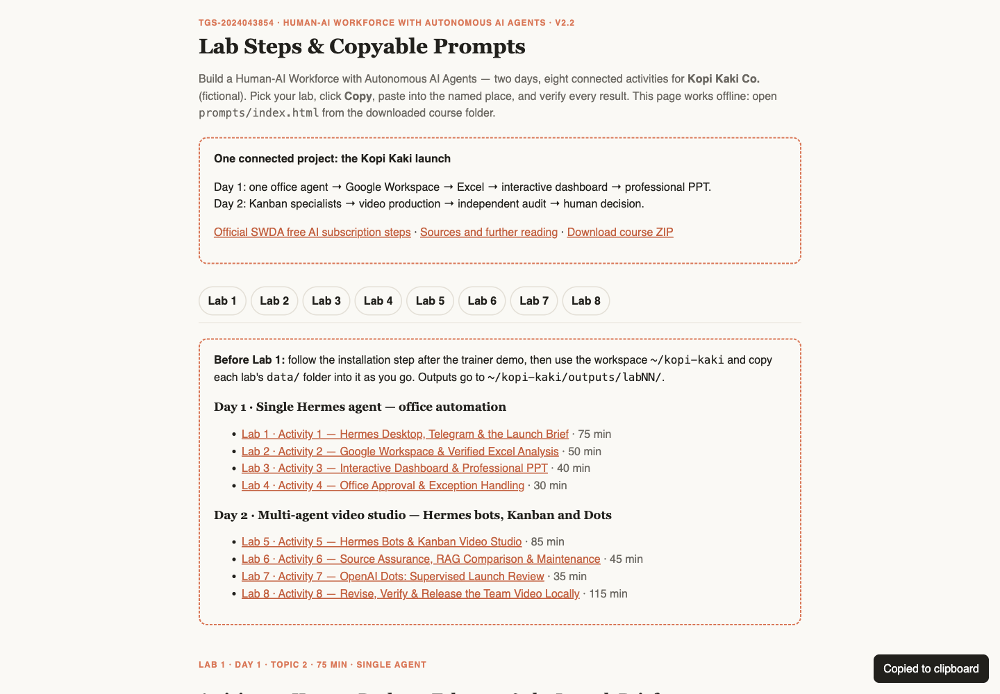

# Build a Human–AI Workforce with Autonomous AI Agents

WSQ **TGS-2024043854** · Tertiary Infotech Academy Pte Ltd · **v2.2, 29 October 2026**

Two days, one fictional Kopi Kaki launch and **eight connected activities: four per day**. Topic 1 covers the 2026 human–AI landscape, AI history,48 practical workflows, collaboration modes, science and clearly labelled humanoid futures. The engineering timeline uses overlapping teaching lenses, not invention dates.

[Open steps and copyable prompts](https://tertiarycourses.github.io/TGS-2024043854-Build-a-Human-AI-Workforce-with-Autonomous-AI-Agents/prompts/index.html) · [Sources](prompts/resources.html) · [Download course ZIP](https://github.com/tertiarycourses/TGS-2024043854-Build-a-Human-AI-Workforce-with-Autonomous-AI-Agents/archive/refs/heads/main.zip)

| Day | Focus | Outputs |
|---|---|---|
| 1 | One Hermes Desktop agent, tools and skills | Telegram, assigned Google office brief, verified Excel, interactive dashboard, professional PPT and human approval |
| 2 | Hermes bots and multi-agent Kanban; OpenAI Dots comparison | Real video team, source assurance, supervised Dots review, playable MP4, independent audit and exact-version local acceptance |

9:30 am–6:30 pm both days. 16 scheduled course hours excluding lunch include 13 hours instruction/practice, 1 hour tea breaks and 2 hours assessment. Tea is included in the scheduled LU allocations; this is not a claim of 14 net instructional hours.

## Start here

1. Download and unzip the course repository.
2. Read the official SWDA subscription steps at the beginning of the course. Check the current **Free AI sub** course label and personal eligibility. Redemption follows eligible attendance; it is separate from lab/API/Dots access.
3. After the lunch demonstration, use [Activity1](labs/lab01-hermes-first-ai-employee/README.md) to download [Hermes Desktop](https://hermes-agent.nousresearch.com/desktop), select the local training profile and connect Telegram.
4. Follow the prompt page in order. Native Windows learners use the supplied PowerShell setup guide in Activities2/3/5/8; keep tools and credentials in the selected native runtime.
5. Inspect real outputs and complete each verification checkpoint. Tools such as gog,Python and FFmpeg are not extra agents.

## Eight connected activities

| Activity | Day | Exercise | Time |
|---|---|---|---|
| 1 | 1 | [Desktop + Telegram](labs/lab01-hermes-first-ai-employee/README.md) | 75 min |
| 2 | 1 | [Google + Excel](labs/lab02-hermes-social-media-campaign/README.md) | 50 min |
| 3 | 1 | [Dashboard + Professional PPT](labs/lab03-hermes-office-artifacts/README.md) | 40 min |
| 4 | 1 | [Office Approval](labs/lab04-hermes-office-approval/README.md) | 30 min |
| 5 | 2 | [Hermes Kanban Video Team](labs/lab05-hermes-kanban-video-team/README.md) | 85 min |
| 6 | 2 | [Source Assurance](labs/lab06-hermes-source-assurance/README.md) | 45 min |
| 7 | 2 | [Dots Launch Review](labs/lab07-openai-dots-launch-review/README.md) | 35 min |
| 8 | 2 | [Video Revision + Release](labs/lab08-hermes-video-release/README.md) | 115 min |

## Practical evidence

PP Task1: **ONE Telegram interaction screenshot** from Activity1. PP Task2: **ONE professional PPT screenshot** from Activity3, with skills/tools working evidence retained. PP Task3: **ONE actual video-creation screenshot with a multi-agent Kanban team and Hermes bots** from Activity5 or8. Complete the written analysis in the current candidate paper and keep source files, PPTX, tool/run logs, MP4, independent audit and human decision available for verification.

Assessment papers,answer keys,FG/AP and private trainer material are distributed through the authorised LMS/Drive workflow and are excluded from this public repository.

The trainer preflights approved model access, assigned Google training records and OAuth, native tools/skills, actual separate Hermes profiles/bots and a tested local video renderer. Dots access is checked independently; record a real trainer demonstration as observed rather than personally executed. No paid video-generation API is required for the reviewed local renderer. All company data is synthetic. Final release in class means a **local package**; no sending, sharing or public posting is required.

© Tertiary Infotech Academy Pte Ltd
